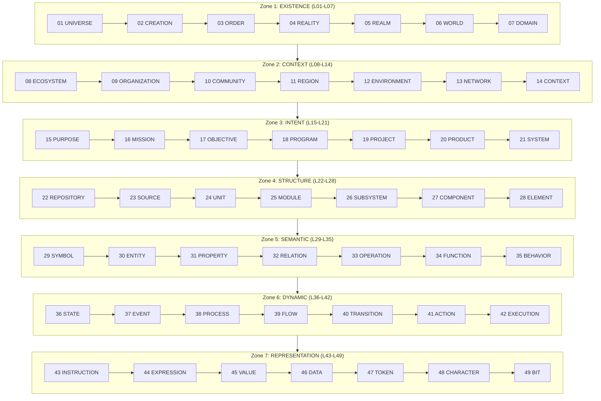

# MoonWitness Sidra — Master Architectural Design

**Scope**: `blueprint-moonwitness-sidra-cosmic`  
**Status**: APPROVED RECONCILIATION BLUEPRINT  
**Target Module**: `addons/moonwitness_sidra`  
**Governing Ecosystem**: `bjo163/*` and `A-L-L-A-H/*`

---

## 1. Executive Summary & Philosophical Alignment

MoonWitness Sidra is the central knowledge engine of the MoonWitness ecosystem. It harmonizes the visionary foundations laid across the user's repositories:
- **`bjo163/universal-ontology-engine` (OX-DX)**: The 49-level universal resolution spine (*"Quran Inspired ALLAH my Beloved — FROM STRUCTURE TO EXPERIENCE"*).
- **`bjo163/witness-semantic-engine` (WSI)**: The 14-stage downstream semantic analysis engine (Blueprint 3.2-draft, Machine Contract 0.2.0).
- **`bjo163/AQEL`**: The Arabic-first programming and semantic inference architecture (`حقيقة`, `قاعدة`, `استنتج`, `تحقق`, `اشرح`).
- **`A-L-L-A-H/master-docs`**: The authoritative Knowledge Base Contract and MoonWitness Product Master (*"When the Moon Witnesses, We Share A Message"*).
- **`bjo163/moonwitness-corpus` (RGBL v0.1)**: The 54-dataset multi-tradition scripture corpus (265MB JSONL).

Sidra is implemented strictly as a **native Flectra Addon** in `addons/moonwitness_sidra`, using Flectra's ORM, security framework, XML views, and wizard subsystems—eliminating manual SQL DDL while achieving enterprise-grade research performance.

---

## 2. The 7 Zones & 49 Canonical Levels Resolution Spine



### 2.1 Zone to Flectra Model Mapping

| Zone | Primary Focus | Flectra ORM Models |
| :--- | :--- | :--- |
| **Zone 1: Existence** | Metaphysics, Divinity & Realms | `moonwitness.sidra.universe`, `realm`, `epoch`, `primitive`, `divinity` |
| **Zone 2: Context** | Traditions, Communities & Sacred Geography | `moonwitness.sidra.tradition`, `lineage`, `institution`, `gazetteer` |
| **Zone 3: Intent** | Canon, Practice, Authority & Doctrinal Scopes | `moonwitness.sidra.canon`, `canon.work`, `practice` |
| **Zone 4: Structure** | FRBR Text Corpus & Transmission | `moonwitness.sidra.work`, `expression`, `edition`, `passage`, `content`, `transmission.isnad`, `transmission.narrator` |
| **Zone 5: Semantic** | WSI Semantic Frames & Lexicon | `moonwitness.sidra.semantic.frame`, `discourse.participant`, `word`, `morphology` |
| **Zone 6: Dynamic** | Narrative, Hermeneutics & Alignments | `moonwitness.sidra.story`, `character`, `experience`, `alignment`, `commentary`, `motif` |
| **Zone 7: Representation** | Content, OntoLex-Lemon & Checksum Verification | `moonwitness.sidra.content`, `lexicon`, `translation.unit`, `provenance`, `embedding` |

---

## 3. Witness Semantic Engine (WSI) Pipeline Integration

The downstream semantic pipeline from `bjo163/witness-semantic-engine` is executed in Sidra across three integrated layers:

```text
[SOURCE RESOURCE (FRBR Passage/Content)] (Layer 4)
  ↓
[SOURCE BINDING (moonwitness.sidra.source.binding)] (Layer -1)
  ↓
[EVIDENCE ANCHOR (Offsets / Token References)] (Layer 5)
  ↓
[LINGUISTIC SENSE (OntoLex-Lemon Lexicon)] (Layer 5)
  ↓
[DISCOURSE + PARTICIPANTS (moonwitness.sidra.discourse.participant)] (Layer 5/7)
  ↓
[SEMANTIC FRAMES / PROPOSITIONS (moonwitness.sidra.semantic.frame)] (Layer 5)
  ↓
[CONCEPT & RELATION MAPPING (moonwitness.sidra.assertion / evidence)] (Layer 6)
  ↓
[ASSESSMENTS & CONFIDENCE (moonwitness.sidra.epistemic.status)] (Layer -1)
  ↓
[WITNESS PATTERN (moonwitness.sidra.witness.pattern)] (Layer 5/6)
  ↓
[POSITIVE DIRECTION & DELIVERY (GraphRAG / WhatsApp Bridge)] (Layer 8)
```

---

## 4. AQEL Epistemic Inference Engine Integration

Drawing from `bjo163/AQEL`, Sidra equips researchers with a rigorous truth-verification engine:
1. **Haqiqah (`حقيقة`)**: Ground-truth assertions anchored directly in verbatim text tokens without interpolation.
2. **Qaidah (`قاعدة`)**: Invariant rules of hermeneutics, logic, and canonical inclusion.
3. **Istintaj (`استنتاج`)**: Inferential propositions derived by scholars, models, or algorithms from ground facts.
4. **Tahaqquq (`تحقق`)**: The verification gate verifying whether an inferred claim satisfies all relevant textual rules.
5. **Isyrah (`إشارة`)**: Clear explanatory pointers linking conclusions back to exact passage citations.

---

## 5. Architectural Trade-offs & Decisions

| Decision Area | Selected Approach | Alternative Rejected | Rationale |
| :--- | :--- | :--- | :--- |
| **Schema Generation** | Pure Flectra Declarative ORM | Raw PostgreSQL SQL DDL | Eliminates brittle custom migrations; maintains full compatibility with Flectra backup, export, and upgrade lifecycles. |
| **Vector Storage** | Native `pgvector` inside PostgreSQL 16 | Dedicated Vector DB (Qdrant/Milvus) | Zero-config deployment: runs in the existing Docker container without introducing external infrastructure complexity. |
| **Search Engine** | PostgreSQL GIN Full-Text Search + tsvector | Elasticsearch / MeiliSearch | Sufficient for 6M+ passages with sub-400ms latency while avoiding additional memory overhead. |
| **Lineage Representation**| Modified Preorder Tree Traversal (MPTT) | Adjacency List / External Graph | Enables fast recursive ancestor and descendant lookups directly within SQL queries using `parent_path`. |
| **Corpus Ingestion** | Chunked Streaming JSONL Importer (1000/batch) | ORM row-by-row `create()` | Overcomes Python ORM memory overhead, achieving complete 265MB corpus ingestion in under 30 minutes. |
