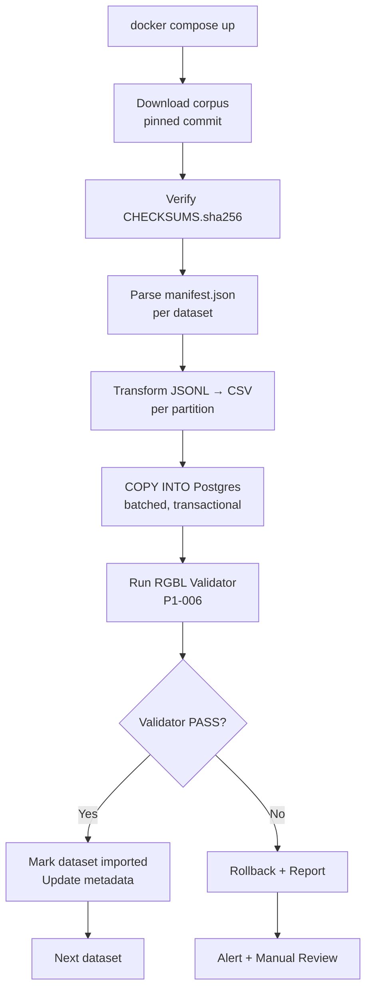

# MoonWitness Sidra — Design Specification

**Project**: New Flectra addon `moonwitness_sidra` (depends on `moonwitness_base`)  
**Data Source**: `bjo163/moonwitness-corpus` (RGBL v0.1) — 54 datasets, 265MB JSONL, 130 files  
**Architecture**: 11-layer model (Layers −2 to 8) fully aligned with RGBL v0.1 contracts  
**Stack**: Flectra 3.0 (Odoo-like) + Postgres 16 + single docker-compose stack (zero-config)  
**Spec Version**: 1.0 | **Date**: 2026-11-21 | **Status**: Draft for Review

---

## 1. Overview & Principles

### 1.1 Purpose
MoonWitness Sidra is a **provenance-first, multi-tradition knowledge center** for textual research and verification. It ingests the RGBL v0.1 corpus (Quran, Hadith, Bible, Pali Canon, Sanskrit sutras, and 49 other traditions), exposes it through a structured FRBR/LRMoo-compliant data model, and provides research-grade tooling: full-text search, cross-tradition alignment, linguistic analysis, narrative exploration, and GraphRAG-powered querying with hallucination audit.

### 1.2 Core Principles (Non-Negotiable, from RGBL v0.1)

| Principle | RGBL Source | Design Implication |
|-----------|-------------|-------------------|
| **Entity ≠ Assertion** | `model.md` | Stable entities (Person, Place, Concept, Work); contextual classifications as scoped Assertions |
| **Translation ≠ Source Identity** | `textual-semantic-rules.json` → `translation-identity` | Separate Content records per Expression; never merge translation into source Passage |
| **Similarity ≠ Equivalence** | `textual-semantic-rules.json` → `similarity-equivalence` | Alignment = review candidate with strength score; never auto-promote to equivalence |
| **Claims Must Be Scoped** | `textual-semantic-rules.json` → `assertion-global-fact` | Every Assertion requires `scope` (tradition, lineage, community, source) |
| **Missing ≠ False** | `textual-semantic-rules.json` → `missing-false` | UI/API must not synthesize negative facts from absence of data |
| **Provenance Required** | `textual-semantic-rules.json` → `provenance-required` | Every record traces to artifact + SHA256 + license + acquisition timestamp |
| **Assessment ≠ Universal Scalar** | `model.md` | Confidence/authenticity belongs to Assessor + Method, not to Assertion directly |

### 1.3 Scope Boundaries
- **In Scope**: All 54 RGBL v0.1 datasets; Layers −2 through 8; FTS search; GraphRAG retrieval; WhatsApp orchestrator bridge; audit logging
- **Out of Scope (v1)**: Automated tafsir/exegesis generation; real-time collaboration; federated SPARQL endpoint; mobile app

---

## 2. Layer Architecture (−2 → 8)

```mermaid
graph TB
    subgraph APP["Layer 8: Intelligence & Delivery"]
        L8A[Embeddings<br/>pgvector HNSW]
        L8B[GraphRAG<br/>Hybrid Retrieval]
        L8C[QueryLog<br/>Hallucination Audit]
        L8D[Orchestrator API<br/>WhatsApp Bridge]
    end

    subgraph NARR["Layer 7: Narrative & Phenomenology"]
        L7A[Story<br/>Narrative Arc]
        L7B[Character<br/>GOLEM Ontology]
        L7C[Experience<br/>Subjective Account]
    end

    subgraph RSCH["Layer 6: Research & Evidence"]
        L6A[Assertion<br/>Scoped Claim]
        L6B[Evidence<br/>Passage Link]
        L6C[Alignment<br/>Cross-Tradition]
        L6D[Motif<br/>Thompson/ATU]
        L6E[Commentary<br/>Scholarly Chain]
    end

    subgraph LING["Layer 5: Language & Linguistics"]
        L5A[Lexicon<br/>Language Dictionary]
        L5B[Word<br/>Token: Form/Lemma/POS]
        L5C[Morphology<br/>Paradigm Tables]
        L5D[TranslationUnit<br/>Aligned Segments]
    end

    subgraph CORP["Layer 4: Text Corpus (FRBR/LRMoo)"]
        L4A[Work<br/>Abstract Intellectual Creation]
        L4B[Expression<br/>Specific Form: Language+Script]
        L4C[Edition<br/>Manifestation: Publisher/Date]
        L4D[Passage<br/>Anchored Segment]
        L4E[Content<br/>Atomic Text Block]
        L4F[CitationScheme<br/>Ref System]
    end

    subgraph TRAD["Layer 3: Tradition & Canon"]
        L3A[Tradition<br/>Religion System]
        L3B[Lineage<br/>School Tree MPTT]
        L3C[Canon<br/>Scoped Claim Set]
        L3D[Practice<br/>Ritual/Observance]
        L3E[Institution<br/>Org Hierarchy]
    end

    subgraph COSM["Layer 2: Cosmology"]
        L2A[Universe<br/>Cosmological Model]
        L2B[Realm<br/>World/Dimension]
        L2C[Epoch<br/>Time Cycle]
    end

    subgraph DIV["Layer 1: Existence & Divinity"]
        L1A[Divinity<br/>Deity Entities ±Apophatic]
        L1B[ConsciousnessMode<br/>Revelation/Inspiration/Samadhi]
        L1C[Manifestation<br/>Incarnation/Avatar/Logos]
    end

    subgraph PRIM["Layer 0: Primitive Foundations"]
        L0A[Being]
        L0B[Consciousness]
        L0C[Will]
        L0D[Knowledge]
        L0E[Power]
        L0F[Life]
        L0G[Speech]
        L0H[Ineffable<br/>Apophatic Marker]
    end

    subgraph EPIS["Layer −1: Provenance & Epistemics (Cross-Layer)"]
        LM1A[Provenance<br/>Source→SHA256→License→Time]
        LM1B[EpistemicStatus<br/>attested|inferred|contested...]
        LM1C[Confidence<br/>0.0–1.0 + Assessor]
        LM1D[AuditLog<br/>Immutable Create/Write/Unlink]
    end

    subgraph META["Layer −2: Meta-Ontology"]
        LM2A[Category<br/>BFO/DOLCE: Continuant/Occurrent...]
        LM2B[RelationType<br/>is-a|part-of|manifests|aligns...]
        LM2C[Scheme<br/>SKOS|Thompson|QuranicOntology...]
    end

    %% Cross-layer dependencies
    L8A --> L4E
    L8B --> L6A
    L8B --> L6C
    L8B --> L7B
    L8C --> L8B
    L8D --> L8B

    L7A --> L4D
    L7A --> L6D
    L7B --> L3A
    L7B --> L1A
    L7C --> L7B

    L6A --> LM1A
    L6A --> LM1B
    L6B --> L4D
    L6C --> L4D
    L6D --> L3A
    L6E --> L4D

    L5A --> L4B
    L5B --> L5A
    L5B --> L4D
    L5C --> L5B
    L5D --> L4D
    L5D --> L5B

    L4A --> L3A
    L4B --> L4A
    L4C --> L4B
    L4D --> L4C
    L4E --> L4D
    L4E --> L4B
    L4F --> L4D

    L3A -.-> L2A
    L3B --> L3A
    L3C --> L3A
    L3C --> L3B
    L3C --> L4A
    L3D --> L3A
    L3E --> L3A

    L1A --> L0A
    L1A --> L0B
    L1A --> L0H
    L1B --> L1A
    L1C --> L1A

    L0A -.-> LM2A
    L0H -.-> LM2A

    %% Layer -1 applies to ALL
    LM1A -.-> L4E
    LM1A -.-> L6A
    LM1A -.-> L5B
    LM1A -.-> L7B
    LM1A -.-> L8C
    LM1B -.-> L6A
    LM1B -.-> L6C
    LM1B -.-> L4E
    LM1C -.-> L6A
    LM1C -.-> L8C
    LM1D -.-> ALL

    classDef app fill:#e8f5e9,stroke:#2e7d32;
    classDef narr fill:#e3f2fd,stroke:#1565c0;
    classDef rsch fill:#fff3e0,stroke:#ef6c00;
    classDef ling fill:#fce4ec,stroke:#c2185b;
    classDef corp fill:#f3e5f5,stroke:#7b1fa2;
    classDef trad fill:#e0f2f1,stroke:#00695c;
    classDef cosm fill:#f1f8e9,stroke:#558b2f;
    classDef div fill:#fbe9e7,stroke:#bf360c;
    classDef prim fill:#eceff1,stroke:#455a64;
    classDef epis fill:#fff8e1,stroke:#f9a825;
    classDef meta fill:#efebe9,stroke:#5d4037;

    class L8A,L8B,L8C,L8D app;
    class L7A,L7B,L7C narr;
    class L6A,L6B,L6C,L6D,L6E rsch;
    class L5A,L5B,L5C,L5D ling;
    class L4A,L4B,L4C,L4D,L4E,L4F corp;
    class L3A,L3B,L3C,L3D,L3E trad;
    class L2A,L2B,L2C cosm;
    class L1A,L1B,L1C div;
    class L0A,L0B,L0C,L0D,L0E,L0F,L0G,L0H prim;
    class LM1A,LM1B,LM1C,LM1D epis;
    class LM2A,LM2B,LM2C meta;
```

### 2.1 Layer Responsibility Summary

| Layer | Responsibility | Primary Models | RGBL Profiles |
|-------|---------------|----------------|---------------|
| −2 | Meta-ontology: rules about the model | Category, RelationType, Scheme | — |
| −1 | Provenance & Epistemics (infrastructure) | Provenance, EpistemicStatus, Confidence, AuditLog | `source`, `scholarly` |
| 0 | Primitive categories (7 + Ineffable) | Primitive | `contextual` |
| 1 | Divinity entities with apophatic/kataphatic attributes | Divinity, ConsciousnessMode, Manifestation | `contextual`, `lineage` |
| 2 | Cosmological structures | Universe, Realm, Epoch | `contextual` |
| 3 | Tradition, Lineage (MPTT), Canon (scoped), Practice, Institution | Tradition, Lineage, Canon, Practice, Institution | `lineage`, `bibliographic` |
| 4 | FRBR/LRMoo Text Corpus | Work, Expression, Edition, Passage, Content, CitationScheme | `textual`, `bibliographic`, `source` |
| 5 | Linguistics: Lexicon, Word, Morphology, TranslationUnit | Lexicon, Word, Morphology, TranslationUnit | `lexicon`, `textual` |
| 6 | Research: Assertion, Evidence, Alignment, Motif, Commentary | Assertion, Evidence, Alignment, Motif, Commentary | `scholarly`, `contextual`, `variants` |
| 7 | Narrative: Story, Character (GOLEM), Experience | Story, Character, CharacterParticipation, Experience | `contextual`, `variants` |
| 8 | Intelligence: Embeddings, GraphRAG, QueryLog, Orchestrator API | Embedding, KGNode, KGEdge, QueryLog | `scholarly`, `source` |

---

## 3. Data Model per Layer (Postgres DDL)

### 3.1 Conventions
- **Naming**: `moonwitness_sidra_<model>` tables; `mw_sidra_` prefix for sequences/indices
- **PK**: `id TEXT PRIMARY KEY` — deterministic IDs (P1-002) or curated UUIDs
- **FK**: Explicit `REFERENCES` with `ON DELETE RESTRICT` (no cascade)
- **Provenance**: Every table has `provenance_record_id TEXT REFERENCES moonwitness_sidra_provenance(id) NOT NULL`
- **Epistemic**: Every assertion-bearing table has `epistemic_status_id TEXT REFERENCES moonwitness_sidra_epistemic_status(id)`
- **Timestamps**: `created_at TIMESTAMPTZ DEFAULT now()`, `updated_at TIMESTAMPTZ`
- **Indexes**: GIN for JSONB/tsvector; GIST for ltree; HNSW for vector; B-tree for FK/lookup

### 3.2 Layer −1: Provenance & Epistemics

```sql
-- moonwitness_sidra_provenance
CREATE TABLE moonwitness_sidra_provenance (
    id                  TEXT PRIMARY KEY,                    -- mw:provenance:<dataset>:<sha256:12>
    source_url          TEXT NOT NULL,
    source_descriptor   JSONB NOT NULL,                      -- {availability, byte_size, locations[], media_type, retrieved_at, sha256}
    institution_id      TEXT REFERENCES moonwitness_sidra_institution(id),
    rights              JSONB NOT NULL,                      -- {attribution, license_uri, rights_statement, notice}
    acquired_at         TIMESTAMPTZ NOT NULL,
    acquired_by         TEXT NOT NULL,                       -- 'human' | 'pipeline' | 'llm-extraction'
    pipeline_version    TEXT,
    created_at          TIMESTAMPTZ DEFAULT now()
);
CREATE INDEX idx_provenance_acquired_at ON moonwitness_sidra_provenance(acquired_at);
CREATE INDEX idx_provenance_institution ON moonwitness_sidra_provenance(institution_id);

-- moonwitness_sidra_epistemic_status
CREATE TABLE moonwitness_sidra_epistemic_status (
    id                  TEXT PRIMARY KEY,                    -- mw:epistemic:<status>:<scope_hash>
    record_id           TEXT NOT NULL,                       -- polymorphic target
    record_type         TEXT NOT NULL,                       -- 'work'|'expression'|'edition'|'passage'|'content'|'assertion'|'alignment'|'assessment'|'word'|'character'|'story'
    status              TEXT NOT NULL,                       -- vocab: attested|inferred|reconstructed|contested|rejected|unknown
    scope               JSONB NOT NULL,                      -- {tradition_id, lineage_id, community, source_id}
    assessor_id         TEXT REFERENCES moonwitness_sidra_assessor(id),
    method              TEXT,                                -- 'manual' | 'rule' | 'llm' | 'community-consensus'
    confidence          NUMERIC(4,3),                        -- 0.000–1.000
    assessed_at         TIMESTAMPTZ DEFAULT now(),
    provenance_record_id TEXT REFERENCES moonwitness_sidra_provenance(id) NOT NULL
);
CREATE INDEX idx_epistemic_record ON moonwitness_sidra_epistemic_status(record_type, record_id);
CREATE INDEX idx_epistemic_scope ON moonwitness_sidra_epistemic_status USING GIN(scope);

-- moonwitness_sidra_assessor
CREATE TABLE moonwitness_sidra_assessor (
    id                  TEXT PRIMARY KEY,
    name                TEXT NOT NULL,
    type                TEXT NOT NULL,                       -- 'human' | 'rule' | 'llm' | 'community'
    credentials         JSONB,
    created_at          TIMESTAMPTZ DEFAULT now()
);

-- moonwitness_sidra_audit_log (immutable, append-only)
CREATE TABLE moonwitness_sidra_audit_log (
    id                  BIGSERIAL PRIMARY KEY,
    table_name          TEXT NOT NULL,
    record_id           TEXT NOT NULL,
    operation           TEXT NOT NULL,                       -- 'INSERT' | 'UPDATE' | 'DELETE'
    user_id             INTEGER REFERENCES res_users(id),
    session_id          TEXT,
    old_values          JSONB,
    new_values          JSONB,
    changed_fields      TEXT[],
    timestamp           TIMESTAMPTZ DEFAULT now()
);
CREATE INDEX idx_audit_record ON moonwitness_sidra_audit_log(table_name, record_id);
CREATE INDEX idx_audit_timestamp ON moonwitness_sidra_audit_log(timestamp);
```

### 3.3 Layer 0: Primitives

```sql
-- moonwitness_sidra_primitive
CREATE TABLE moonwitness_sidra_primitive (
    id                  TEXT PRIMARY KEY,                    -- mw:primitive:being|consciousness|will|knowledge|power|life|speech|ineffable
    code                TEXT UNIQUE NOT NULL,                -- being|consciousness|will|knowledge|power|life|speech|ineffable
    name                JSONB NOT NULL,                      -- multilingual labels
    definition          TEXT,
    apophatic_note      TEXT,                                -- what it is NOT (via negativa)
    kataphatic_note     TEXT,                                -- what it IS (via positiva)
    provenance_record_id TEXT REFERENCES moonwitness_sidra_provenance(id) NOT NULL,
    created_at          TIMESTAMPTZ DEFAULT now()
);
```

### 3.4 Layer 1: Divinity & Consciousness

```sql
-- moonwitness_sidra_divinity
CREATE TABLE moonwitness_sidra_divinity (
    id                  TEXT PRIMARY KEY,                    -- mw:divinity:<tradition>:<name>
    tradition_id        TEXT REFERENCES moonwitness_sidra_tradition(id) NOT NULL,
    name                JSONB NOT NULL,                      -- multilingual
    epithets            JSONB,                               -- array of {text, language, source_ref}
    apophatic_attributes JSONB,                              -- {attr: {affirmed:bool, denied:bool, qualified:text, source_ref}}
    kataphatic_attributes JSONB,                             -- {attr: {value:text, certainty:float, source_ref}}
    iconography_refs    TEXT[],                              -- ir.attachment IDs
    provenance_record_id TEXT REFERENCES moonwitness_sidra_provenance(id) NOT NULL,
    epistemic_status_id TEXT REFERENCES moonwitness_sidra_epistemic_status(id),
    created_at          TIMESTAMPTZ DEFAULT now(),
    updated_at          TIMESTAMPTZ
);
CREATE INDEX idx_divinity_tradition ON moonwitness_sidra_divinity(tradition_id);

-- moonwitness_sidra_consciousness_mode
CREATE TABLE moonwitness_sidra_consciousness_mode (
    id                  TEXT PRIMARY KEY,
    tradition_id        TEXT REFERENCES moonwitness_sidra_tradition(id) NOT NULL,
    name                JSONB NOT NULL,                      -- 'revelation' | 'inspiration' | 'samadhi' | 'gnosis' | 'prophecy' | 'ilham' | 'wahy'
    description         TEXT,
    divinity_id         TEXT REFERENCES moonwitness_sidra_divinity(id),
    provenance_record_id TEXT REFERENCES moonwitness_sidra_provenance(id) NOT NULL
);

-- moonwitness_sidra_manifestation
CREATE TABLE moonwitness_sidra_manifestation (
    id                  TEXT PRIMARY KEY,
    divinity_id         TEXT REFERENCES moonwitness_sidra_divinity(id) NOT NULL,
    tradition_id        TEXT REFERENCES moonwitness_sidra_tradition(id) NOT NULL,
    name                JSONB NOT NULL,                      -- 'incarnation' | 'avatar' | 'logos' | 'ruh' | 'theophany'
    form_description    TEXT,
    passage_ids         TEXT[],                              -- mw:passage:* refs
    provenance_record_id TEXT REFERENCES moonwitness_sidra_provenance(id) NOT NULL
);
```

### 3.5 Layer 2: Cosmology

```sql
-- moonwitness_sidra_universe
CREATE TABLE moonwitness_sidra_universe (
    id                  TEXT PRIMARY KEY,
    tradition_id        TEXT REFERENCES moonwitness_sidra_tradition(id) NOT NULL,
    name                JSONB NOT NULL,
    description         TEXT,
    structure_json      JSONB,                               -- {heavens: 7, hells: 7, earth: 1, mount_meru: true...}
    provenance_record_id TEXT REFERENCES moonwitness_sidra_provenance(id) NOT NULL
);

-- moonwitness_sidra_realm
CREATE TABLE moonwitness_sidra_realm (
    id                  TEXT PRIMARY KEY,
    universe_id         TEXT REFERENCES moonwitness_sidra_universe(id) NOT NULL,
    name                JSONB NOT NULL,
    realm_type          TEXT,                                -- 'heaven' | 'hell' | 'earth' | 'intermediate' | 'pure_land' | 'devaloka'
    description         TEXT,
    inhabitants         TEXT[],                              -- divinity/character IDs
    provenance_record_id TEXT REFERENCES moonwitness_sidra_provenance(id) NOT NULL
);

-- moonwitness_sidra_epoch
CREATE TABLE moonwitness_sidra_epoch (
    id                  TEXT PRIMARY KEY,
    tradition_id        TEXT REFERENCES moonwitness_sidra_tradition(id) NOT NULL,
    name                JSONB NOT NULL,                      -- 'kali_yuga' | 'dispensation' | 'era_of_prophet' | 'mappo'
    start_marker        TEXT,                                -- event or date
    end_marker          TEXT,
    duration_years      BIGINT,
    sequence            INT,
    provenance_record_id TEXT REFERENCES moonwitness_sidra_provenance(id) NOT NULL
);
```

### 3.6 Layer 3: Tradition, Lineage, Canon, Practice, Institution

```sql
-- moonwitness_sidra_tradition
CREATE TABLE moonwitness_sidra_tradition (
    id                  TEXT PRIMARY KEY,                    -- e.g., 'islam', 'christianity', 'buddhism'
    code                TEXT UNIQUE NOT NULL,
    name                JSONB NOT NULL,                      -- multilingual
    native_name         TEXT,
    tradition_type      TEXT NOT NULL,                       -- 'major_world_religion' | 'indigenous_tradition' | 'historical_reconstruction' | 'new_religious_movement'
    historical_status   TEXT NOT NULL,                       -- 'living' | 'historical'
    geographic_scope    TEXT,
    living_status       TEXT,
    textuality          TEXT,                                -- 'written_canon' | 'oral_corpus' | 'mixed'
    description         TEXT,
    primary_languages   TEXT[],                              -- ISO 639-3 codes
    scripts             TEXT[],                              -- ISO 15924 codes
    adherents_estimate  BIGINT,
    aliases             TEXT[],
    provenance_record_id TEXT REFERENCES moonwitness_sidra_provenance(id) NOT NULL,
    created_at          TIMESTAMPTZ DEFAULT now()
);

-- moonwitness_sidra_lineage (MPTT)
CREATE TABLE moonwitness_sidra_lineage (
    id                  TEXT PRIMARY KEY,
    tradition_id        TEXT REFERENCES moonwitness_sidra_tradition(id) NOT NULL,
    parent_id           TEXT REFERENCES moonwitness_sidra_lineage(id),
    name                JSONB NOT NULL,
    code                TEXT NOT NULL,
    description         TEXT,
    epistemic_status_id TEXT REFERENCES moonwitness_sidra_epistemic_status(id),
    parent_path         LTREE,                               -- for ancestor queries
    lft                 INT,                                 -- MPTT
    rgt                 INT,
    depth               INT,
    provenance_record_id TEXT REFERENCES moonwitness_sidra_provenance(id) NOT NULL
);
CREATE INDEX idx_lineage_parent_path ON moonwitness_sidra_lineage USING GIST(parent_path);
CREATE INDEX idx_lineage_tradition ON moonwitness_sidra_lineage(tradition_id);

-- moonwitness_sidra_canon
CREATE TABLE moonwitness_sidra_canon (
    id                  TEXT PRIMARY KEY,
    tradition_id        TEXT REFERENCES moonwitness_sidra_tradition(id) NOT NULL,
    lineage_id          TEXT REFERENCES moonwitness_sidra_lineage(id),
    name                TEXT NOT NULL,                       -- 'Sunni Hadith Canon', 'Pali Tipitaka', 'Muratorian Canon'
    scope               TEXT NOT NULL,                       -- 'scripture' | 'law' | 'liturgy' | 'commentary' | 'creed'
    authority_level     TEXT NOT NULL,                       -- 'binding' | 'authoritative' | 'influential' | 'rejected'
    attestation_date    DATE,
    description         TEXT,
    provenance_record_id TEXT REFERENCES moonwitness_sidra_provenance(id) NOT NULL
);

-- moonwitness_sidra_canon_work (Canon ↔ Work membership)
CREATE TABLE moonwitness_sidra_canon_work (
    id                  TEXT PRIMARY KEY,
    canon_id            TEXT REFERENCES moonwitness_sidra_canon(id) NOT NULL,
    work_id             TEXT REFERENCES moonwitness_sidra_work(id) NOT NULL,
    status              TEXT NOT NULL,                       -- 'included' | 'excluded' | 'disputed'
    note                TEXT,
    provenance_record_id TEXT REFERENCES moonwitness_sidra_provenance(id) NOT NULL
);
CREATE UNIQUE INDEX idx_canon_work_unique ON moonwitness_sidra_canon_work(canon_id, work_id);

-- moonwitness_sidra_practice
CREATE TABLE moonwitness_sidra_practice (
    id                  TEXT PRIMARY KEY,
    tradition_id        TEXT REFERENCES moonwitness_sidra_tradition(id) NOT NULL,
    lineage_id          TEXT REFERENCES moonwitness_sidra_lineage(id),
    name                JSONB NOT NULL,
    practice_type       TEXT NOT NULL,                       -- 'ritual' | 'observance' | 'prayer' | 'fast' | 'pilgrimage' | 'meditation' | 'chant' | 'sacrament'
    frequency           TEXT,                                -- 'daily' | 'weekly' | 'annual' | 'lifecycle' | 'conditional'
    prescribed_text_ids TEXT[],                              -- mw:passage:* refs
    description         TEXT,
    provenance_record_id TEXT REFERENCES moonwitness_sidra_provenance(id) NOT NULL
);

-- moonwitness_sidra_institution
CREATE TABLE moonwitness_sidra_institution (
    id                  TEXT PRIMARY KEY,
    tradition_id        TEXT REFERENCES moonwitness_sidra_tradition(id) NOT NULL,
    lineage_id          TEXT REFERENCES moonwitness_sidra_lineage(id),
    name                JSONB NOT NULL,
    institution_type    TEXT NOT NULL,                       -- 'madrasa' | 'monastery' | 'church' | 'mosque' | 'temple' | 'university' | 'order' | 'council'
    founded             DATE,
    location            TEXT,
    parent_institution_id TEXT REFERENCES moonwitness_sidra_institution(id),
    provenance_record_id TEXT REFERENCES moonwitness_sidra_provenance(id) NOT NULL
);
```

### 3.7 Layer 4: Text Corpus (FRBR/LRMoo)

```sql
-- moonwitness_sidra_work (FRBR Work)
CREATE TABLE moonwitness_sidra_work (
    id                  TEXT PRIMARY KEY,                    -- mw:work:quran
    kind                TEXT NOT NULL,                       -- vocab: text-genres.json (scripture, hadith, sutra, gospel, epistle, commentary, creed, liturgy, law, poetry, narrative, philosophical)
    title               JSONB NOT NULL,                      -- multilingual labels (preferred/alternate, lang, script)
    tradition_id        TEXT REFERENCES moonwitness_sidra_tradition(id) NOT NULL,
    description         TEXT,
    date_composed       TEXT,                                -- fuzzy date: '610-632 CE', '1st c. BCE'
    language_original   TEXT,                                -- ISO 639-3 of original language
    provenance_record_id TEXT REFERENCES moonwitness_sidra_provenance(id) NOT NULL,
    epistemic_status_id TEXT REFERENCES moonwitness_sidra_epistemic_status(id),
    created_at          TIMESTAMPTZ DEFAULT now(),
    updated_at          TIMESTAMPTZ
);
CREATE INDEX idx_work_tradition ON moonwitness_sidra_work(tradition_id);
CREATE INDEX idx_work_kind ON moonwitness_sidra_work(kind);

-- moonwitness_sidra_expression (FRBR Expression)
CREATE TABLE moonwitness_sidra_expression (
    id                  TEXT PRIMARY KEY,                    -- mw:expression:quran:ar-uthmani
    work_id             TEXT REFERENCES moonwitness_sidra_work(id) NOT NULL,
    language            TEXT NOT NULL,                       -- ISO 639-3
    script              TEXT NOT NULL,                       -- ISO 15924
    content_type        TEXT NOT NULL,                       -- 'source' | 'translation' | 'transliteration' | 'commentary' | 'abridgement' | 'adaptation'
    translation_of      TEXT REFERENCES moonwitness_sidra_expression(id), -- self-ref for translations
    title               JSONB,                               -- expression-specific title
    editor              TEXT,
    date_expressed      TEXT,
    provenance_record_id TEXT REFERENCES moonwitness_sidra_provenance(id) NOT NULL,
    epistemic_status_id TEXT REFERENCES moonwitness_sidra_epistemic_status(id),
    created_at          TIMESTAMPTZ DEFAULT now()
);
CREATE INDEX idx_expression_work ON moonwitness_sidra_expression(work_id);
CREATE INDEX idx_expression_lang ON moonwitness_sidra_expression(language);
CREATE INDEX idx_expression_type ON moonwitness_sidra_expression(content_type);

-- moonwitness_sidra_edition (FRBR Manifestation / LRMoo Edition)
CREATE TABLE moonwitness_sidra_edition (
    id                  TEXT PRIMARY KEY,                    -- mw:edition:tanzil-uthmani-1.1
    expression_id       TEXT REFERENCES moonwitness_sidra_expression(id) NOT NULL,
    edition_name        TEXT NOT NULL,                       -- 'Cairo 1924', 'KFGD', 'NA28', 'Mahasangiti'
    publisher           TEXT,
    publication_date    DATE,
    publication_place   TEXT,
    license_uri         TEXT,                                -- SPDX
    rights_statement    TEXT,
    checksum_sha256     CHAR(64),                            -- from provenance
    isbn                TEXT,
    issn                TEXT,
    format              TEXT,                                -- 'plain_text' | 'xml' | 'jsonl' | 'pdf'
    provenance_record_id TEXT REFERENCES moonwitness_sidra_provenance(id) NOT NULL,
    epistemic_status_id TEXT REFERENCES moonwitness_sidra_epistemic_status(id),
    created_at          TIMESTAMPTZ DEFAULT now()
);
CREATE INDEX idx_edition_expression ON moonwitness_sidra_edition(expression_id);

-- moonwitness_sidra_citation_scheme (profil textual.citation_scheme)
CREATE TABLE moonwitness_sidra_citation_scheme (
    id                  TEXT PRIMARY KEY,                    -- mw:citation-scheme:quran:surah-ayah
    delimiter           TEXT NOT NULL,                       -- ':'
    components          JSONB NOT NULL,                      -- [{key:'surah',unit:'surah'},{key:'ayah',unit:'ayah'}]
    example             TEXT,                                -- '2:255'
    tradition_id        TEXT REFERENCES moonwitness_sidra_tradition(id),
    provenance_record_id TEXT REFERENCES moonwitness_sidra_provenance(id) NOT NULL
);

-- moonwitness_sidra_passage (LRMoo Passage)
CREATE TABLE moonwitness_sidra_passage (
    id                  TEXT PRIMARY KEY,                    -- mw:passage:quran:2:255
    edition_id          TEXT REFERENCES moonwitness_sidra_edition(id) NOT NULL,
    container_id        TEXT REFERENCES moonwitness_sidra_passage(id), -- self-ref for hierarchy (surah→ayah)
    local_id            TEXT NOT NULL,                       -- '2:255' or 'bukhari:1:1'
    sequence            INT NOT NULL,                        -- global ordering within edition
    unit                TEXT NOT NULL,                       -- 'surah' | 'ayah' | 'hadith' | 'chapter' | 'verse' | 'sutta' | 'vagga' | 'book'
    citation_scheme_id  TEXT REFERENCES moonwitness_sidra_citation_scheme(id),
    path                LTREE,                               -- materialized path for ancestor queries
    provenance_record_id TEXT REFERENCES moonwitness_sidra_provenance(id) NOT NULL,
    epistemic_status_id TEXT REFERENCES moonwitness_sidra_epistemic_status(id),
    created_at          TIMESTAMPTZ DEFAULT now()
);
CREATE INDEX idx_passage_edition ON moonwitness_sidra_passage(edition_id);
CREATE INDEX idx_passage_container ON moonwitness_sidra_passage(container_id);
CREATE INDEX idx_passage_path ON moonwitness_sidra_passage USING GIST(path);
CREATE INDEX idx_passage_local_id ON moonwitness_sidra_passage(local_id);

-- moonwitness_sidra_content (Atomic Text Block)
CREATE TABLE moonwitness_sidra_content (
    id                  TEXT PRIMARY KEY,                    -- mw:content:quran:2:255:ar-uthmani
    passage_id          TEXT REFERENCES moonwitness_sidra_passage(id) NOT NULL,
    expression_id       TEXT REFERENCES moonwitness_sidra_expression(id) NOT NULL,
    text                TEXT NOT NULL,                       -- actual text content
    text_search         TSVECTOR,                            -- generated: to_tsvector(lang, text)
    char_start          INT,                                 -- offset in passage (for alignment)
    char_end            INT,
    byte_size           INT,
    is_primary          BOOLEAN DEFAULT FALSE,               -- one primary per passage per expression
    provenance_record_id TEXT REFERENCES moonwitness_sidra_provenance(id) NOT NULL,
    epistemic_status_id TEXT REFERENCES moonwitness_sidra_epistemic_status(id),
    created_at          TIMESTAMPTZ DEFAULT now(),
    updated_at          TIMESTAMPTZ
);
CREATE INDEX idx_content_passage ON moonwitness_sidra_content(passage_id);
CREATE INDEX idx_content_expression ON moonwitness_sidra_content(expression_id);
CREATE INDEX idx_content_fts ON moonwitness_sidra_content USING GIN(text_search);
CREATE UNIQUE INDEX idx_content_primary ON moonwitness_sidra_content(passage_id, expression_id) WHERE is_primary;

-- Trigger for FTS (simplified; actual uses language-specific config)
CREATE OR REPLACE FUNCTION moonwitness_sidra_content_fts_trigger()
RETURNS TRIGGER AS $$
BEGIN
    NEW.text_search := to_tsvector(
        CASE NEW.expression_id
            WHEN (SELECT id FROM moonwitness_sidra_expression WHERE language='ara' LIMIT 1) THEN 'arabic'
            WHEN (SELECT id FROM moonwitness_sidra_expression WHERE language='pli' LIMIT 1) THEN 'simple'
            WHEN (SELECT id FROM moonwitness_sidra_expression WHERE language='san' LIMIT 1) THEN 'simple'
            ELSE 'english'
        END,
        NEW.text
    );
    RETURN NEW;
END;
$$ LANGUAGE plpgsql;
CREATE TRIGGER content_fts_trigger
BEFORE INSERT OR UPDATE ON moonwitness_sidra_content
FOR EACH ROW EXECUTE FUNCTION moonwitness_sidra_content_fts_trigger();
```

### 3.8 Layer 5: Linguistics

```sql
-- moonwitness_sidra_lexicon
CREATE TABLE moonwitness_sidra_lexicon (
    id                  TEXT PRIMARY KEY,                    -- mw:lexicon:quranic-arabic
    language            TEXT NOT NULL,                       -- ISO 639-3
    script              TEXT NOT NULL,                       -- ISO 15924
    name                TEXT NOT NULL,
    version             TEXT,
    source_uri          TEXT,
    license             TEXT,
    entry_count         INT,
    provenance_record_id TEXT REFERENCES moonwitness_sidra_provenance(id) NOT NULL
);

-- moonwitness_sidra_word (Token-level)
CREATE TABLE moonwitness_sidra_word (
    id                  TEXT PRIMARY KEY,                    -- mw:word:quranic-arabic:rahman
    lexicon_id          TEXT REFERENCES moonwitness_sidra_lexicon(id) NOT NULL,
    form                TEXT NOT NULL,                       -- surface form
    lemma               TEXT,                                -- lemma/root form
    pos                 TEXT,                                -- UD v2 tag: NOUN, VERB, ADJ, etc.
    morph_features      JSONB,                               -- {"Gender":"Masc","Number":"Sing","Case":"Nom"}
    root                TEXT,                                -- Semitic root (Arabic/Hebrew) / dhatu (Sanskrit)
    pattern             TEXT,                                -- Arabic pattern (faʿlān) / Sanskrit derivational pattern
    vocalization        TEXT,                                -- fully vocalized form
    frequency           INT DEFAULT 0,
    provenance_record_id TEXT REFERENCES moonwitness_sidra_provenance(id) NOT NULL,
    epistemic_status_id TEXT REFERENCES moonwitness_sidra_epistemic_status(id)
);
CREATE INDEX idx_word_lexicon ON moonwitness_sidra_word(lexicon_id);
CREATE INDEX idx_word_lemma ON moonwitness_sidra_word(lemma);
CREATE INDEX idx_word_root ON moonwitness_sidra_word(root) WHERE root IS NOT NULL;
CREATE INDEX idx_word_pos ON moonwitness_sidra_word(pos);
CREATE INDEX idx_word_morph ON moonwitness_sidra_word USING GIN(morph_features);

-- moonwitness_sidra_morphology (Paradigm Tables)
CREATE TABLE moonwitness_sidra_morphology (
    id                  TEXT PRIMARY KEY,
    lexicon_id          TEXT REFERENCES moonwitness_sidra_lexicon(id) NOT NULL,
    lemma               TEXT NOT NULL,
    paradigm            JSONB NOT NULL,                      -- {"form1": {"Gender":"Masc","Number":"Sing"}, "form2": {...}}
    paradigm_type       TEXT NOT NULL,                       -- 'noun' | 'verb' | 'adj' | 'pron' | 'num'
    irregular           BOOLEAN DEFAULT FALSE,
    provenance_record_id TEXT REFERENCES moonwitness_sidra_provenance(id) NOT NULL
);
CREATE INDEX idx_morph_lemma ON moonwitness_sidra_morphology(lexicon_id, lemma);

-- moonwitness_sidra_translation_unit (Aligned Segments)
CREATE TABLE moonwitness_sidra_translation_unit (
    id                  TEXT PRIMARY KEY,
    source_passage_id   TEXT REFERENCES moonwitness_sidra_passage(id) NOT NULL,
    target_passage_id   TEXT REFERENCES moonwitness_sidra_passage(id) NOT NULL,
    source_words        TEXT[],                              -- mw:word:* IDs
    target_words        TEXT[],                              -- mw:word:* IDs
    alignment_score     NUMERIC(4,3),                        -- 0.000–1.000
    aligner             TEXT NOT NULL,                       -- 'manual' | 'eflomal' | 'awesome-align' | 'simalign'
    provenance_record_id TEXT REFERENCES moonwitness_sidra_provenance(id) NOT NULL,
    epistemic_status_id TEXT REFERENCES moonwitness_sidra_epistemic_status(id)
);
CREATE INDEX idx_tu_source ON moonwitness_sidra_translation_unit(source_passage_id);
CREATE INDEX idx_tu_target ON moonwitness_sidra_translation_unit(target_passage_id);
```

### 3.9 Layer 6: Research & Evidence

```sql
-- moonwitness_sidra_assertion
CREATE TABLE moonwitness_sidra_assertion (
    id                  TEXT PRIMARY KEY,                    -- mw:assertion:v1:sha256:... or curated
    assertion_class     TEXT NOT NULL,                       -- vocab: assertion-classes.json (explicit_source|source_summary|scholarly_interpretation|derived|hypothesis)
    assertion_type      TEXT NOT NULL,                       -- vocab: assertion-type.ttl (textual|historical|doctrinal|linguistic|philosophical)
    subject_id          TEXT NOT NULL,                       -- polymorphic: entity/work/passage/concept/character
    subject_type        TEXT NOT NULL,
    predicate_id        TEXT REFERENCES moonwitness_sidra_predicate(id),
    object_id           TEXT NOT NULL,
    object_type         TEXT NOT NULL,
    scope               JSONB NOT NULL,                      -- REQUIRED per RGBL: {tradition_id, lineage_id, community, source_id}
    confidence          NUMERIC(4,3),                        -- 0.000–1.000
    provenance_record_id TEXT REFERENCES moonwitness_sidra_provenance(id) NOT NULL,
    epistemic_status_id TEXT REFERENCES moonwitness_sidra_epistemic_status(id),
    author_id           INTEGER REFERENCES res_users(id),
    created_at          TIMESTAMPTZ DEFAULT now(),
    updated_at          TIMESTAMPTZ
);
CREATE INDEX idx_assertion_subject ON moonwitness_sidra_assertion(subject_type, subject_id);
CREATE INDEX idx_assertion_object ON moonwitness_sidra_assertion(object_type, object_id);
CREATE INDEX idx_assertion_scope ON moonwitness_sidra_assertion USING GIN(scope);

-- moonwitness_sidra_evidence
CREATE TABLE moonwitness_sidra_evidence (
    id                  TEXT PRIMARY KEY,                    -- mw:evidence:v1:sha256:...
    assertion_id        TEXT REFERENCES moonwitness_sidra_assertion(id) NOT NULL,
    passage_id          TEXT REFERENCES moonwitness_sidra_passage(id) NOT NULL,
    relation            TEXT NOT NULL,                       -- vocab: evidence-relations.json (supports|contradicts|mentions|quotes|paraphrases|interprets|contextualizes|parallels|alludes_to)
    excerpt_start       INT,
    excerpt_end         INT,
    note                TEXT,
    provenance_record_id TEXT REFERENCES moonwitness_sidra_provenance(id) NOT NULL,
    epistemic_status_id TEXT REFERENCES moonwitness_sidra_epistemic_status(id)
);
CREATE INDEX idx_evidence_assertion ON moonwitness_sidra_evidence(assertion_id);
CREATE INDEX idx_evidence_passage ON moonwitness_sidra_evidence(passage_id);

-- moonwitness_sidra_alignment
CREATE TABLE moonwitness_sidra_alignment (
    id                  TEXT PRIMARY KEY,
    source_passage_id   TEXT REFERENCES moonwitness_sidra_passage(id) NOT NULL,
    target_passage_id   TEXT REFERENCES moonwitness_sidra_passage(id) NOT NULL,
    alignment_type      TEXT NOT NULL,                       -- vocab: alignment-type.ttl (parallel|quotation|allusion|thematic|structural)
    strength            NUMERIC(4,3),                        -- 0.000–1.000
    method              TEXT NOT NULL,                       -- 'manual' | 'auto-embed' | 'auto-lexical' | 'auto-motif'
    notes               TEXT,
    provenance_record_id TEXT REFERENCES moonwitness_sidra_provenance(id) NOT NULL,
    epistemic_status_id TEXT REFERENCES moonwitness_sidra_epistemic_status(id)
);
CREATE INDEX idx_align_source ON moonwitness_sidra_alignment(source_passage_id);
CREATE INDEX idx_align_target ON moonwitness_sidra_alignment(target_passage_id);
CREATE INDEX idx_align_strength ON moonwitness_sidra_alignment(strength DESC);

-- moonwitness_sidra_motif
CREATE TABLE moonwitness_sidra_motif (
    id                  TEXT PRIMARY KEY,                    -- 'A1010' | 'quran:flood' | 'buddha:great_renunciation'
    label               TEXT NOT NULL,
    description         TEXT,
    motif_index         TEXT,                                -- 'Thompson' | 'ATU' | 'custom'
    tradition_ids       TEXT[],                              -- mw:tradition:* refs
    passage_ids         TEXT[],                              -- mw:passage:* refs
    parent_id           TEXT REFERENCES moonwitness_sidra_motif(id),
    provenance_record_id TEXT REFERENCES moonwitness_sidra_provenance(id) NOT NULL
);
CREATE INDEX idx_motif_tradition ON moonwitness_sidra_motif USING GIN(tradition_ids);

-- moonwitness_sidra_commentary
CREATE TABLE moonwitness_sidra_commentary (
    id                  TEXT PRIMARY KEY,
    target_passage_id   TEXT REFERENCES moonwitness_sidra_passage(id) NOT NULL,
    commentary_passage_id TEXT REFERENCES moonwitness_sidra_passage(id) NOT NULL,
    layer               INT DEFAULT 1,                       -- 1=direct, 2=meta-commentary...
    commentary_type     TEXT,                                -- 'tafsir' | 'exegesis' | 'scholium' | 'gloss' | 'translation_note'
    author              TEXT,
    language            TEXT,
    date                DATE,
    source_ref          TEXT,
    provenance_record_id TEXT REFERENCES moonwitness_sidra_provenance(id) NOT NULL
);
CREATE INDEX idx_commentary_target ON moonwitness_sidra_commentary(target_passage_id);

-- moonwitness_sidra_predicate (from vocab/predicates.json)
CREATE TABLE moonwitness_sidra_predicate (
    id                  TEXT PRIMARY KEY,                    -- mw:predicate:mentions
    label               TEXT NOT NULL,
    inverse_id          TEXT REFERENCES moonwitness_sidra_predicate(id),
    domain_types        TEXT[],                              -- allowed subject types
    range_types         TEXT[],                              -- allowed object types
    provenance_record_id TEXT REFERENCES moonwitness_sidra_provenance(id) NOT NULL
);
```

### 3.10 Layer 7: Narrative & Phenomenology

```sql
-- moonwitness_sidra_story
CREATE TABLE moonwitness_sidra_story (
    id                  TEXT PRIMARY KEY,
    tradition_id        TEXT REFERENCES moonwitness_sidra_tradition(id) NOT NULL,
    title               JSONB NOT NULL,
    summary             TEXT,
    narrative_type      TEXT NOT NULL,                       -- 'myth' | 'history' | 'parable' | 'vision' | 'genealogy' | 'law' | 'hymn' | 'lament'
    protagonist_ids     TEXT[],                              -- mw:character:* refs
    passage_ids         TEXT[],                              -- ordered mw:passage:* refs
    motif_ids           TEXT[],                              -- mw:motif:* refs
    provenance_record_id TEXT REFERENCES moonwitness_sidra_provenance(id) NOT NULL
);

-- moonwitness_sidra_character (GOLEM Ontology)
CREATE TABLE moonwitness_sidra_character (
    id                  TEXT PRIMARY KEY,
    tradition_id        TEXT REFERENCES moonwitness_sidra_tradition(id) NOT NULL,
    name                JSONB NOT NULL,
    epithets            JSONB,                               -- array of {text, lang, source}
    character_type      TEXT NOT NULL,                       -- 'divine' | 'human' | 'angel' | 'jinn' | 'animal' | 'object' | 'abstract'
    ontological_status  TEXT NOT NULL,                       -- GOLEM: 'endurant' | 'perdurant' | 'quality' | 'role'
    divinity_id         TEXT REFERENCES moonwitness_sidra_divinity(id),
    attributes          JSONB,                               -- {immortal: true, omniscient: false, ...}
    provenance_record_id TEXT REFERENCES moonwitness_sidra_provenance(id) NOT NULL,
    epistemic_status_id TEXT REFERENCES moonwitness_sidra_epistemic_status(id)
);
CREATE INDEX idx_character_tradition ON moonwitness_sidra_character(tradition_id);
CREATE INDEX idx_character_type ON moonwitness_sidra_character(character_type);

-- moonwitness_sidra_character_participation
CREATE TABLE moonwitness_sidra_character_participation (
    id                  TEXT PRIMARY KEY,
    character_id        TEXT REFERENCES moonwitness_sidra_character(id) NOT NULL,
    story_id            TEXT REFERENCES moonwitness_sidra_story(id) NOT NULL,
    event_id            TEXT REFERENCES moonwitness_sidra_passage(id) NOT NULL,
    role                TEXT NOT NULL,                       -- 'agent' | 'patient' | 'experiencer' | 'beneficiary' | 'instrument' | 'location' | 'source' | 'goal'
    tense               TEXT NOT NULL,                       -- 'past' | 'present' | 'future' | 'timeless'
    provenance_record_id TEXT REFERENCES moonwitness_sidra_provenance(id) NOT NULL
);

-- moonwitness_sidra_experience
CREATE TABLE moonwitness_sidra_experience (
    id                  TEXT PRIMARY KEY,
    character_id        TEXT REFERENCES moonwitness_sidra_character(id) NOT NULL,
    passage_id          TEXT REFERENCES moonwitness_sidra_passage(id) NOT NULL,
    experience_type     TEXT NOT NULL,                       -- vocab: experience-type.ttl (perceptual|emotional|cognitive|volitional|mystical)
    valence             TEXT NOT NULL,                       -- 'positive' | 'negative' | 'neutral' | 'mixed'
    intensity           SMALLINT CHECK (intensity BETWEEN 1 AND 10),
    description         TEXT,
    provenance_record_id TEXT REFERENCES moonwitness_sidra_provenance(id) NOT NULL,
    epistemic_status_id TEXT REFERENCES moonwitness_sidra_epistemic_status(id)
);
```

### 3.11 Layer 8: Intelligence & Delivery

```sql
-- moonwitness_sidra_embedding (pgvector)
CREATE TABLE moonwitness_sidra_embedding (
    id                  TEXT PRIMARY KEY,                    -- same as content_id
    content_id          TEXT REFERENCES moonwitness_sidra_content(id) NOT NULL,
    embedding           VECTOR(1024),                        -- bge-m3 or chosen model
    model_name          TEXT NOT NULL,                       -- 'bge-m3' | 'e5-mistral-7b' | 'jina-v3'
    model_version       TEXT,
    created_at          TIMESTAMPTZ DEFAULT now()
);
CREATE INDEX idx_embedding_hnsw ON moonwitness_sidra_embedding USING hnsw (embedding vector_cosine_ops)
    WITH (m = 16, ef_construction = 64);

-- moonwitness_sidra_kg_node (Knowledge Graph Nodes)
CREATE TABLE moonwitness_sidra_kg_node (
    id                  TEXT PRIMARY KEY,                    -- mw:kg:node:<entity_id>
    entity_id           TEXT NOT NULL,                       -- polymorphic ref
    entity_type         TEXT NOT NULL,                       -- 'work'|'expression'|'edition'|'passage'|'content'|'character'|'divinity'|'primitive'|'motif'|'concept'
    label               TEXT NOT NULL,
    properties          JSONB,                               -- flexible attributes
    provenance_record_id TEXT REFERENCES moonwitness_sidra_provenance(id) NOT NULL
);
CREATE INDEX idx_kg_node_entity ON moonwitness_sidra_kg_node(entity_type, entity_id);
CREATE INDEX idx_kg_node_label ON moonwitness_sidra_kg_node(label);

-- moonwitness_sidra_kg_edge (Knowledge Graph Edges)
CREATE TABLE moonwitness_sidra_kg_edge (
    id                  TEXT PRIMARY KEY,
    source_id           TEXT REFERENCES moonwitness_sidra_kg_node(id) NOT NULL,
    target_id           TEXT REFERENCES moonwitness_sidra_kg_node(id) NOT NULL,
    relation_type       TEXT NOT NULL,                       -- from vocab/predicates.json + 'aligns_with' | 'participates_in' | 'manifests_as'
    weight              NUMERIC(4,3) DEFAULT 1.0,
    properties          JSONB,
    provenance_record_id TEXT REFERENCES moonwitness_sidra_provenance(id) NOT NULL
);
CREATE INDEX idx_kg_edge_source ON moonwitness_sidra_kg_edge(source_id);
CREATE INDEX idx_kg_edge_target ON moonwitness_sidra_kg_edge(target_id);
CREATE INDEX idx_kg_edge_type ON moonwitness_sidra_kg_edge(relation_type);

-- moonwitness_sidra_query_log (Hallucination Audit)
CREATE TABLE moonwitness_sidra_query_log (
    id                  BIGSERIAL PRIMARY KEY,
    session_id          TEXT,
    query_text          TEXT NOT NULL,
    retrieved_passage_ids TEXT[],                            -- mw:passage:* refs
    retrieved_scores    NUMERIC[],
    generated_answer    TEXT,
    citations           JSONB,                               -- [{"passage_id": "...", "text_excerpt": "...", "score": 0.92}]
    hallucination_score NUMERIC(4,3),                        -- 0.000–1.000 (self-consistency check)
    user_feedback       TEXT,                                -- 'accurate' | 'partial' | 'hallucinated' | 'harmful'
    latency_ms          INT,
    model_name          TEXT,
    model_version       TEXT,
    created_at          TIMESTAMPTZ DEFAULT now()
);
CREATE INDEX idx_query_session ON moonwitness_sidra_query_log(session_id);
CREATE INDEX idx_query_created ON moonwitness_sidra_query_log(created_at);
CREATE INDEX idx_query_hallucination ON moonwitness_sidra_query_log(hallucination_score DESC);
```

---

## 4. Vocabulary & Profile Mapping (RGBL v0.1 → Sidra)

| RGBL Vocab File | Sidra Model/Field | Layer | Notes |
|-----------------|-------------------|-------|-------|
| `epistemic-status.ttl` | `moonwitness_sidra_epistemic_status.status` | −1 | attested, inferred, reconstructed, contested, rejected, unknown |
| `work-type.ttl` | `moonwitness_sidra_work.kind` | 4 | scripture, hadith, sutra, gospel, epistle, commentary, creed, liturgy, law, poetry, narrative, philosophical |
| `alignment-type.ttl` | `moonwitness_sidra_alignment.alignment_type` | 6 | parallel, quotation, allusion, thematic, structural |
| `golem.ttl` | `moonwitness_sidra_character.ontological_status` | 7 | endurant, perdurant, quality, role |
| `assertion-type.ttl` | `moonwitness_sidra_assertion.assertion_type` | 6 | textual, historical, doctrinal, linguistic, philosophical |
| `experience-type.ttl` | `moonwitness_sidra_experience.experience_type` | 7 | perceptual, emotional, cognitive, volitional, mystical |
| `primitives.ttl` | `moonwitness_sidra_primitive.code` | 0 | being, consciousness, will, knowledge, power, life, speech, ineffable |
| `assertion-classes.json` | `moonwitness_sidra_assertion.assertion_class` | 6 | explicit_source, source_summary, scholarly_interpretation, derived, hypothesis |
| `entity-kinds.json` | Entity classification (polymorphic) | All | person, group, place, event, concept, practice, tradition, community, institution, being, object |
| `evidence-relations.json` | `moonwitness_sidra_evidence.relation` | 6 | supports, contradicts, mentions, quotes, paraphrases, interprets, contextualizes, parallels, alludes_to |
| `predicates.json` | `moonwitness_sidra_predicate` | 6 | mentions, has-role, part-of, derived-from, broader-than, related-to, ... |
| `religious-roles.json` | Divinity/Character roles | 1, 7 | prophet, deity, angel, saint, sage, bodhisattva, ... |
| `text-genres.json` | `moonwitness_sidra_work.kind` | 4 | (same as work-type.ttl) |

### 4.1 RGBL Profiles → Layer Mapping

| RGBL Profile | Purpose | Sidra Layers |
|--------------|---------|--------------|
| `textual@0.1` | Work/Expression/Edition/Passage/Content + CitationScheme | 4 |
| `bibliographic@0.1` | Publisher, date, rights, ISBN, format | 4 (Edition) |
| `source@0.1` | Provenance, acquisition, checksums, rights | −1, 4 |
| `lexicon@0.1` | Lexicon, Word, Morphology | 5 |
| `lineage@0.1` | Tradition, Lineage (MPTT), Canon | 3 |
| `scholarly@0.1` | Assertion, Evidence, Assessment, Commentary | 6 |
| `contextual@0.1` | Tradition metadata, Practice, Institution, Divinity, Cosmology | 1, 2, 3 |
| `manuscript@0.1` | Manuscript witnesses, collation (future) | — |
| `media@0.1` | Audio/Video recordings of recitation (future) | — |
| `variants@0.1` | Textual variants, Alignment, Motif, Commentary chain | 6, 7 |

---

## 5. Invariant & Validation Rules (P1-006)

### 5.1 Implemented Validators (Python Service: `moonwitness_sidra.validator`)

| Code | Rule | Layer | Action on Violation |
|------|------|-------|---------------------|
| `record-family-id-kind` | Assertion ID must be `mw:assertion:...`; Evidence `mw:evidence:...`; Provenance `mw:provenance:...`; Assessment `mw:assessment:...` | All | ERROR — block import/commit |
| `nonblank-kind` | `Work.kind`, `Content.content_type`, `Assertion.assertion_class`, `Evidence.relation`, `Assessment.result` ≠ '' | 4, 6 | ERROR |
| `nonblank-assertion-class` | `Assertion.assertion_class` ∈ vocab | 6 | ERROR |
| `nonblank-evidence-relation` | `Evidence.relation` ∈ vocab | 6 | ERROR |
| `nonblank-assessment-result` | `EpistemicStatus.status` ∈ vocab | −1 | ERROR |
| `deterministic-id-mismatch` | For IDs matching `mw:<type>:v1:sha256:<64hex>`, recompute hash from canonical payload; must match exactly | All | ERROR — data corruption detected |
| `malformed-deterministic-id` | ID looks like v1:sha256 but digest not 64 lowercase hex | All | ERROR |
| `provenance-required` | Every record has non-null `provenance_record_id` FK resolving to valid Provenance | All | ERROR |
| `scope-required` | Every Assertion has non-empty `scope` JSONB with at least `tradition_id` | 6 | ERROR |
| `translation-identity` | Content with `content_type='translation'` must have `translation_of` pointing to source Expression | 4 | ERROR |
| `similarity-equivalence` | Alignment `strength` < 1.0 unless `alignment_type='parallel'` AND human-reviewed | 6 | WARNING (auto-promote blocked) |
| `missing-false` | UI/API must not return "not found" as negative fact; return `null` with `epistemic_status='unknown'` | All | WARNING (UI contract) |

### 5.2 Validator Architecture

```python
# moonwitness_sidra/validator.py
class RGBLValidator:
    def __init__(self, env):
        self.env = env
        self.vocab = self._load_vocab()

    def validate_all(self, models=None):
        """Run all P1-006 checks. Returns list of Findings."""
        findings = []
        findings.extend(self._check_record_family_ids())
        findings.extend(self._check_nonblank_fields())
        findings.extend(self._check_deterministic_ids())
        findings.extend(self._check_provenance_coverage())
        findings.extend(self._check_assertion_scope())
        findings.extend(self._check_translation_identity())
        findings.extend(self._check_alignment_equivalence())
        return findings

    def _check_deterministic_ids(self):
        # Recompute hash from canonical payload fields
        # Compare with stored ID digest
        pass
```

### 5.3 CI Integration

```yaml
# .github/workflows/sidra-ci.yml (validator job)
- name: Run RGBL Validator
  run: |
    python -m moonwitness_sidra.validator --all-layers --strict
  # Fails if any ERROR-level finding
```

---

## 6. Import Pipeline Spec (JSONL → COPY → Verify)

### 6.1 Source Data Layout (from `bjo163/moonwitness-corpus`)

```
datasets/<dataset-id>/
├── manifest.json              # dataset metadata + partitions
├── CHECKSUMS.sha256
├── data/
│   ├── core/
│   │   ├── entities/          # *.jsonl (Entity records)
│   │   ├── resources/         # *.jsonl (Resource: Work/Expression/Edition/Passage/Content)
│   │   └── provenance/        # *.jsonl (Provenance records)
│   └── extensions/            # optional: lexical, scholarly, etc.
```

### 6.2 Import Flow



### 6.3 Importer Service (`moonwitness_sidra.services.importer`)

```python
class CorpusImporter:
    def __init__(self, env, corpus_dir: Path, commit_sha: str):
        self.env = env
        self.corpus_dir = corpus_dir
        self.commit_sha = commit_sha

    def import_dataset(self, dataset_id: str, batch_size: int = 1000):
        manifest = self._load_manifest(dataset_id)
        self._verify_checksums(dataset_id)
        
        # Order matters: Provenance → Work → Expression → Edition → Passage → Content
        for partition in manifest['partitions']:
            if partition['recordType'] == 'provenance':
                self._import_provenance(dataset_id, partition, batch_size)
            elif partition['recordType'] == 'entity':
                self._import_entities(dataset_id, partition, batch_size)
            elif partition['recordType'] == 'resource':
                self._import_resources(dataset_id, partition, batch_size)

    def _import_resources(self, dataset_id, partition, batch_size):
        # Resources contain Work, Expression, Edition, Passage, Content
        # Sort by dependency order
        for record in self._stream_jsonl(partition['path']):
            kind = record['kind']
            if kind == 'textual.work':
                self._upsert_work(record)
            elif kind == 'textual.expression':
                self._upsert_expression(record)
            # ... etc.
```

### 6.4 Deterministic ID Generation (P1-002)

```python
def compute_deterministic_id(record_type: str, payload: dict) -> str:
    """P1-002: deterministic v1 IDs for Assertion & Evidence."""
    # Canonical fields per record type
    canonical_fields = {
        'assertion': ['assertion_class', 'subject_id', 'subject_type', 'predicate_id', 'object_id', 'object_type', 'scope'],
        'evidence': ['assertion_id', 'passage_id', 'relation', 'excerpt_start', 'excerpt_end'],
    }
    # Sort keys, JSON serialize, SHA256, take first 64 hex
    canonical = {k: payload[k] for k in canonical_fields[record_type] if k in payload}
    serialized = json.dumps(canonical, sort_keys=True, separators=(',', ':'))
    digest = hashlib.sha256(serialized.encode()).hexdigest()
    return f"mw:{record_type}:v1:sha256:{digest}"
```

### 6.5 Import Verification

```python
def verify_import(env, dataset_id: str, expected: dict):
    """Post-import verification."""
    checks = {
        'work_count': count_works(env, dataset_id),
        'passage_count': count_passages(env, dataset_id),
        'content_count': count_content(env, dataset_id),
        'provenance_coverage': provenance_coverage_pct(env),
        'epistemic_coverage': epistemic_coverage_pct(env),
        'checksum_verified': verify_checksums(env, dataset_id),
        'validator_pass': run_validator(env),
    }
    for key, (expected_val, actual_val) in zip(checks.keys(), expected.items()):
        assert actual_val >= expected_val, f"{key}: expected ≥{expected_val}, got {actual_val}"
    return checks
```

---

## 7. API Contract (Orchestrator Bridge + GraphRAG)

### 7.1 Internal Service APIs (Python)

```python
# moonwitness_sidra.services.retriever
class HybridRetriever:
    def retrieve(self, query: str, k: int = 20, strategy: str = 'hybrid',
                 tradition_ids: list = None, language: str = None) -> list[RetrievedPassage]:
        """
        Returns fused results from:
        1. Vector similarity (pgvector HNSW) — weight 0.4
        2. Graph traversal (2-hop from seed entities) — weight 0.3
        3. Full-text search (Postgres FTS) — weight 0.3
        Reciprocal Rank Fusion (RRF) with k=60.
        """
        pass

# moonwitness_sidra.services.embeddings
class EmbeddingService:
    def embed_text(self, text: str) -> list[float]: ...
    def embed_batch(self, texts: list[str]) -> list[list[float]]: ...
    def build_hnsw_index(self, batch_size: int = 512): ...
```

### 7.2 HTTP Endpoints (Flectra Controllers)

| Method | Path | Description | Auth |
|--------|------|-------------|------|
| `POST` | `/sidra/search` | FTS search: `{query, tradition, language, limit, offset}` → `{passages[], facets, total}` | User |
| `GET` | `/sidra/passage/<id>` | Passage detail with context (±2), all expressions, alignments | User |
| `GET` | `/sidra/work/<id>` | Work hierarchy: expressions → editions → passages | User |
| `POST` | `/sidra/query` | GraphRAG query: `{query, session_id, strategy}` → `{answer, citations[], retrieved_passages[], hallucination_score}` | User |
| `POST` | `/sidra/feedback` | User feedback on query: `{query_log_id, feedback, correction?}` | User |
| `GET` | `/sidra/alignment/<source_id>` | Alignments for a passage (source or target) | User |
| `GET` | `/sidra/word/<id>` | Word detail: form, lemma, POS, morph, root, concordance | User |
| `GET` | `/sidra/character/<id>` | Character network: stories, participations, experiences | User |

### 7.3 Orchestrator Bridge (WhatsApp)

```python
# In moonwitness_orchestrator (external service)
@app.post("/sidra/query")
async def sidra_query(request: SidraQueryRequest):
    """Called by WhatsApp webhook handler."""
    async with httpx.AsyncClient() as client:
        resp = await client.post(
            f"{FLECTRA_URL}/sidra/query",
            json={"query": request.query, "session_id": request.session_id},
            headers={"Authorization": f"Bearer {SIDRA_API_TOKEN}"}
        )
    data = resp.json()
    # Format for WhatsApp: answer + citation footnotes
    return format_whatsapp_response(data)
```

### 7.4 OpenAPI Spec (Auto-generated)

```yaml
openapi: 3.0.3
info:
  title: MoonWitness Sidra API
  version: 1.0.0
servers:
  - url: https://{domain}/sidra
paths:
  /search:
    post:
      summary: Full-text search passages
      requestBody:
        content:
          application/json:
            schema:
              $ref: '#/components/schemas/SearchRequest'
      responses:
        '200':
          description: Search results
          content:
            application/json:
              schema:
                $ref: '#/components/schemas/SearchResponse'
components:
  schemas:
    SearchRequest:
      type: object
      properties:
        query: {type: string}
        tradition: {type: string}
        language: {type: string}
        limit: {type: integer, default: 20}
        offset: {type: integer, default: 0}
    SearchResponse:
      type: object
      properties:
        passages:
          type: array
          items: {$ref: '#/components/schemas/PassageResult'}
        facets:
          type: object
        total: {type: integer}
    PassageResult:
      type: object
      properties:
        id: {type: string}
        canonical_ref: {type: string}
        text: {type: string}
        language: {type: string}
        tradition: {type: string}
        score: {type: number}
        context_before: {type: array, items: {type: string}}
        context_after: {type: array, items: {type: string}}
```

---

## 8. UI/UX Specification

### 8.1 Menu Structure (under existing Moonwitness root)

```
Moonwitness (root menu from moonwitness_base)
├── Arsy (Docker Manager)
├── Orchestrator (WhatsApp)
└── Sidra (Knowledge Center)
    ├── Corpus
    │   ├── Browse (Tradition → Work → Expression → Edition → Passage)
    │   ├── Search (FTS + Facets)
    │   └── Passage Detail (Text + Context + Expressions + Alignments)
    ├── Traditions
    │   ├── Tree View (Tradition → Lineage → Canon)
    │   ├── Canon Matrix (Canon × Work grid)
    │   └── Tradition Detail (Metadata, Practices, Institutions)
    ├── Research
    │   ├── Assertion Browser (Filter: type, scope, status)
    │   ├── Evidence Panel (Passage highlight + Excerpt)
    │   ├── Alignment Matrix (Tradition A × Tradition B heatmap)
    │   ├── Motif Explorer (Tree + Passage links)
    │   └── Commentary Chain (Layered view)
    ├── Linguistics
    │   ├── Interlinear View (Passage → Tokens: Form/Lemma/POS/Morph/Gloss)
    │   ├── Root Concordance (Semitic: click root → all occurrences)
    │   ├── Parallel Translation (Side-by-side + Word alignment highlights)
    │   └── Morphology Paradigm Tables
    ├── Narratives
    │   ├── Story Timeline (Chronological narrative arcs)
    │   ├── Character Network (Force-directed graph, GOLEM types)
    │   ├── Experience Heatmap (Character × Experience Type × Valence)
    │   └── Passage ↔ Story ↔ Character Navigation
    ├── Intelligence
    │   ├── Query Playground (Chat UI + Citation Cards + Feedback)
    │   ├── Retrieval Debug (Vector/Graph/FTS scores breakdown)
    │   └── Hallucination Audit Log (Flagged queries review)
    └── Datasets
        ├── Import Status (Per dataset: records, provenance, validator)
        ├── Provenance Browser (Source → SHA256 → License → Time)
        └── Validation Report (P1-006 findings)
```

### 8.2 Key UI Components

| Component | Technology | Key Features |
|-----------|------------|--------------|
| Corpus Browser | OWL Tree/List + Search Widget | Lazy-load tradition tree; debounced FTS; infinite scroll passages |
| Passage Detail | OWL Form + Kanban (Expressions) | Context nav (±2); expression tabs; alignment sidebar; commentary accordion |
| Alignment Matrix | Custom Canvas/Grid | Tradition A (rows) × Tradition B (cols); cell = count + avg strength; click → passage pairs |
| Interlinear | Virtualized List | 1000+ tokens smooth; click token → root concordance modal |
| Query Playground | React-like (OWL + JS) | Streaming answer; citation cards with passage preview; inline feedback buttons |
| Character Network | D3.js / Cytoscape | GOLEM type coloring; click → character detail; filter by story/motif |

### 8.3 Accessibility (WCAG AA)

- Semantic HTML5 (`<nav>`, `<main>`, `<article>`, `<aside>`)
- ARIA labels on all icon buttons (`aria-label="Search passages"`)
- Focus visible (`:focus-visible { outline: 2px solid #1976d2 }`)
- Color contrast ≥ 4.5:1 (text), 3:1 (UI elements)
- Keyboard navigation: Tab order logical; Escape closes modals; Enter activates
- Screen reader tested (NVDA/VoiceOver)

---

## 9. Phase Plan (16 Weeks)

| Phase | Weeks | Focus | Key Deliverables | Exit Criteria |
|-------|-------|-------|------------------|---------------|
| **1** | 1–4 | Foundation & Core Corpus (Layers −1, 4) | Provenance/Epistemic models, FRBR corpus models, Import pipeline (3 traditions), FTS search, Corpus Browser UI | Week 4: 150MB imported, validator PASS, FTS < 500ms p95, UI functional |
| **2** | 5–8 | Traditions, Canon, Research (Layers 3, 6) | Tradition/Lineage/Canon models, Assertion/Evidence/Alignment/Motif/Commentary, Import all 54 datasets, Cross-tradition alignment, Research Workspace UI | Week 8: 54 datasets imported, >10k alignments, Research UI complete, Data quality dashboard green |
| **3** | 9–11 | Linguistics & Foundation Entities (Layers 5, 0–2) | Lexicon/Word/Morphology/TranslationUnit, 5 lexicons imported, 7 Primitives + 50 Divinity entities, Interlinear & Parallel UI | Week 11: Word lookup < 50ms, 80% passages have parallel translation, Divinity apophatic attrs loaded |
| **4** | 12–15 | Narrative & Intelligence (Layers 7, 8) | Story/Character/Experience, pgvector embeddings, GraphRAG (KG + Hybrid Retrieval), QueryLog with hallucination audit, Query Playground + WhatsApp bridge | Week 15: nDCG@10 ≥ 0.65, latency < 800ms p95, WhatsApp bot replies with citations, Hallucination flag > 90% accuracy |
| **5** | 16–17 | Polish, Archive, Docs | WCAG AA audit, OpenAPI spec, User/Dev guides, Backup/restore tested, Repo archive, Tag `v1.0.0-sidra` | Week 17: Smoke test passes on clean stack, Docs published, Repo archived |

---

## 10. Testing Strategy

### 10.1 Unit Tests (Backend)
- **Model CRUD**: Create/read/update/delete for every model; FK constraints; cascade restrictions
- **Validator**: Each P1-006 rule with positive/negative fixtures
- **Importer**: JSONL → CSV transform; deterministic ID generation; checksum verification
- **Retriever**: Vector/Graph/FTS individual + RRF fusion; known query fixtures

### 10.2 Integration Tests
- **Full Import**: Load test corpus (10MB subset) → validate → query
- **API Endpoints**: Contract tests against OpenAPI spec
- **Orchestrator Bridge**: Mock Flectra → test WhatsApp formatting

### 10.3 Invariant Tests (CI Gate)
```python
# tests/test_validator.py
def test_p1006_record_family_id_kind(env):
    # Assertion with mw:evidence:... ID → ERROR
    pass

def test_p1006_deterministic_id_mismatch(env):
    # Create assertion, mutate payload, keep same ID → ERROR
    pass

def test_p1006_scope_required(env):
    # Assertion without scope → ERROR
    pass
```

### 10.4 Retrieval Evaluation (Phase 4+)
- **Gold Set**: 200 queries × 5 traditions with expert-annotated relevant passages
- **Metrics**: nDCG@10 ≥ 0.65, Recall@20 ≥ 0.80, Citation Precision ≥ 0.90
- **CI Gate**: `retrieval-eval` job blocks merge if nDCG@10 < 0.65

### 10.5 End-to-End (Playwright)
```typescript
// tests/e2e/smoke.spec.ts
test('install → import → search → query → WhatsApp', async ({page}) => {
  await page.goto('/web/login');
  await login(page);
  await installAddon(page, 'moonwitness_sidra');
  await importDataset(page, 'islam-quran');
  await searchPassage(page, 'ar-rahman');
  await queryPlayground(page, 'Ayat tentang rahmat');
  await whatsappSend(page, '+62812...', 'Test from Sidra');
});
```

### 10.6 Performance Benchmarks
| Operation | Target | Measurement |
|-----------|--------|-------------|
| FTS Search (10M passages) | < 200ms p95 | `EXPLAIN ANALYZE` + load test |
| Vector Search (HNSW) | < 100ms p95 | `pgvector` benchmark |
| Graph Traversal (2-hop) | < 150ms p95 | `AGE` / recursive CTE |
| Hybrid Retrieval (RRF) | < 800ms p95 | End-to-end |
| Import (150MB) | < 30 min | Bulk COPY + index |
| Embedding Build (265MB) | < 6 hr (GPU T4) | Batch 512 |

---

## 11. Migration & Archive Checklist

### 11.1 Pre-Migration
- [ ] Pin `bjo163/moonwitness-corpus` commit SHA in `requirements-corpus.txt`
- [ ] Export all 54 `manifest.json` + `CHECKSUMS.sha256` for verification
- [ ] Document any dataset-specific quirks in `docs/rgbl-decisions.md`

### 11.2 Migration Execution
- [ ] Run import pipeline per dataset priority (P0 → P1 → rest)
- [ ] Verify counts match manifest for each dataset
- [ ] Run full validator suite (P1-006) — 0 ERROR
- [ ] Generate import report: entity counts, provenance coverage, epistemic distribution

### 11.3 Post-Migration Validation
- [ ] Spot-check 100 random passages per tradition: text matches source
- [ ] Verify alignment counts: Quran↔Bible > 500, Quran↔Hadith > 1000, etc.
- [ ] Confirm FTS works for Arabic, Pali, Sanskrit, Hebrew, Greek, Indonesian, English

### 11.4 Archive Old Repo
- [ ] Create final release tag `v0.1-final-migration` on `bjo163/moonwitness-corpus`
- [ ] Update README with migration notice + link to Sidra addon
- [ ] GitHub Settings → **Archive this repository**
- [ ] Remove repo from active CI/CD, dependabot, code scanning

---

## 12. Appendix: RGBL v0.1 Cross-Reference Table

| RGBL Spec Section | Sidra Implementation | File/Location |
|-------------------|---------------------|---------------|
| `spec/v0.1/model.md` § Entity vs Assertion | Separate Entity (Work, Character, Divinity) vs Assertion models | `models/corpus_work.py`, `models/assertion.py` |
| `spec/v0.1/model.md` § Multilingual Labels | `title`/`name` JSONB with `{preferred: [], alternate: []}` per lang/script | All models |
| `spec/v0.1/model.md` § Source vs Evidence vs Provenance | Provenance (Layer −1) → Evidence (Layer 6) → Source (Layer 4 Edition) | `models/provenance.py`, `models/evidence.py`, `models/corpus_edition.py` |
| `spec/v0.1/model.md` § Assessment | `EpistemicStatus` + `Assessor` + `Confidence` (not scalar on Assertion) | `models/epistemic.py` |
| `spec/v0.1/semantic-invariants.md` P1-006 | `moonwitness_sidra.validator` with 12 rule codes | `models/validator.py` |
| `spec/v0.1/identifiers.md` P1-002 | Deterministic v1 SHA256 for Assertion/Evidence | `services/importer.py` |
| `spec/v0.1/labels.md` | Multilingual label structure (preferred/alternate, BCP47, ISO15924) | All `name`/`title` JSONB |
| `spec/v0.1/lifecycle.md` | `EpistemicStatus` transitions tracked in `AuditLog` | `models/epistemic.py`, `models/audit.py` |
| `spec/v0.1/referential-integrity.md` | FK constraints + validator referential checks | PostgreSQL FK + `validator.py` |
| `spec/v0.1/profiles/textual.md` | FRBR/LRMoo Work→Expression→Edition→Passage→Content | `models/corpus_*.py` |
| `spec/v0.1/profiles/lexicon.md` | Lexicon, Word, Morphology, TranslationUnit | `models/lexicon.py`, `models/word.py` |
| `spec/v0.1/profiles/lineage.md` | Tradition, Lineage (MPTT), Canon | `models/tradition.py`, `models/lineage.py` |
| `spec/v0.1/profiles/scholarly.md` | Assertion, Evidence, Commentary | `models/assertion.py`, `models/evidence.py` |
| `spec/v0.1/vocab/*.json` | Direct vocab tables (`predicate`, `epistemic_status`, etc.) | `models/vocab_*.py`, `data/*.csv` |
| `config/traditions.json` | Seed data for `moonwitness_sidra_tradition` (54 records) | `data/traditions_seed.xml` |
| `config/textual-semantic-rules.json` | 6 semantic rules → validator codes + UI contracts | `models/validator.py`, UI components |

---

## 13. Open Decisions (Require Resolution)

| ID | Decision | Options | Owner | Due |
|----|----------|---------|-------|-----|
| D1 | **pgvector vs pg_embedding** | `pgvector` (mature, HNSW) vs `pg_embedding` (newer, IVFFlat) | Backend Lead | Week 1 |
| D2 | **Graph Backend** | Apache AGE (Cypher, mature) vs `pg_graph` (native, simpler) | Backend Lead | Week 10 |
| D3 | **Embedding Model** | `bge-m3` (1024d, multilingual) vs `e5-mistral-7b` (4096d) vs `jina-v3` (1024d) | Data Engineer | Week 12 |
| D4 | **WhatsApp Session Persistence** | Orchestrator volume `/data/wa-session` vs Postgres table | DevOps | Week 14 |
| D5 | **Embedding License** | Can we ship derived vectors under RGBL v0.1? | Legal/PM | Week 1 |
| D6 | **Flectra Version** | Target 3.0 only or dual 3.0/4.0 compatibility? | PM | Week 1 |

---

## 14. Sign-Off

| Role | Name | Date | Signature |
|------|------|------|-----------|
| Project Manager | | | |
| Backend Lead | | | |
| Frontend Lead | | | |
| Data Engineer Lead | | | |
| QA Lead | | | |
| DevOps Lead | | | |

---

*Generated: 2026-11-21 | Spec Version: 1.0 | Status: Draft for Review | Next: Stakeholder Review → writing-plans invocation*