# MoonWitness Sidra — 16-Week Implementation Plan

**Project**: New Flectra addon `moonwitness_sidra` (depends on `moonwitness_base`)  
**Data Source**: `bjo163/moonwitness-corpus` (RGBL v0.1) — 54 datasets, 265MB JSONL, 130 files  
**Architecture**: 11-layer model (Layers −2 to 8) fully aligned with RGBL v0.1 contracts  
**Stack**: Flectra (Odoo-like) + Postgres 16 + single docker-compose stack (zero-config)

---

## 1. Work Breakdown Structure (WBS)

### Phase 1: Foundation & Core Corpus (Weeks 1–4)

#### Epic 1.1: Layer −1 — Provenance & Epistemic Status (Cross-Layer Infrastructure)
| Task ID | Story | Task | Role | Est. (pd) | Dependencies |
|---------|-------|------|------|-----------|--------------|
| T1.1.1 | As a system, I need a provenance graph so every entity carries source lineage | Design `moonwitness.provenance.record` abstract model with fields: `source_ref` (char, indexed), `retrieved_at` (datetime), `agent` (char), `method` (selection: api|import|derivation|manual), `confidence` (float 0–1), `checksum` (char, blake3) | Backend | 3 | — |
| T1.1.2 | As a system, I need epistemic status on every assertion | Design `moonwitness.epistemic.status` model with RGBL v0.1 vocab: `attested`, `inferred`, `reconstructed`, `contested`, `rejected`, `unknown`; add `status` field to all Layer 0–8 models via `_inherit` mixin | Backend | 2 | T1.1.1 |
| T1.1.3 | As a developer, I need a validator for P1-006 invariants | Implement `moonwitness.validator` service (Python) with rules: (P1-006.1) every entity has provenance; (P1-006.2) epistemic status ∈ vocab; (P1-006.3) no cycles in provenance graph; (P1-006.4) confidence ∈ [0,1]; (P1-006.5) checksum verifies on load | Backend | 4 | T1.1.1, T1.1.2 |
| T1.1.4 | As a QA, I need CI gate for validator | Add GitHub Actions job `validate-rgbl` running `moonwitness.validator` on all models; fail build on any violation | DevOps | 1 | T1.1.3 |
| T1.1.5 | As a sysadmin, I need audit trail | Create `moonwitness.audit.log` model (immutable, append-only) recording every create/write/unlink on Layer 0–8 with user, timestamp, diff | Backend | 2 | T1.1.1 |

#### Epic 1.2: Layer 4 — Text Corpus (FRBR/LRMoo)
| Task ID | Story | Task | Role | Est. (pd) | Dependencies |
|---------|-------|------|------|-----------|--------------|
| T1.2.1 | As a scholar, I need Work→Expression→Edition→Passage→Content hierarchy | Create models: `moonwitness.corpus.work` (FRBR Work), `moonwitness.corpus.expression` (FRBR Expression), `moonwitness.corpus.edition` (FRBR Manifestation), `moonwitness.corpus.passage` (LRMoo Passage), `moonwitness.corpus.content` (atomic text block); fields per RGBL v0.1 §4.2 | Backend | 5 | T1.1.1 |
| T1.2.2 | As a scholar, I need multilingual expression support | Add `language` (ISO 639-3), `script` (ISO 15924), `translation_of` (many2one to expression) on expression model | Backend | 1 | T1.2.1 |
| T1.2.3 | As a scholar, I need edition metadata (publisher, date, rights) | Add `publisher`, `publication_date`, `license_uri` (SPDX), `rights_statement` on edition model | Backend | 1 | T1.2.1 |
| T1.2.4 | As a scholar, I need passage anchoring (canonical refs) | Add `canonical_ref` (e.g., "Quran 2:255", "John 3:16", "DN 1.1.5"), `ref_system` (selection), `ordinal` on passage model | Backend | 2 | T1.2.1 |
| T1.2.5 | As a scholar, I need content with full text + FTS | Add `text` (text), `text_search` (tsvector, GIN index), `char_start`, `char_end`, `byte_size` on content model; trigger `to_tsvector('arabic'|'english'|...)` on write | Backend | 3 | T1.2.1 |
| T1.2.6 | As a user, I need full-text search UI | Implement FTS search endpoint `/sidra/search` (POST: query, tradition, limit, offset) using `websearch_to_tsquery`; return passage + context window (±2 passages) | Backend | 3 | T1.2.5 |
| T1.2.7 | As a user, I need Corpus Browser UI | Build OWL list/tree views: Tradition → Work → Expression → Edition → Passage; search widget with tradition filter; passage detail panel with context navigation | Frontend | 5 | T1.2.6 |
| T1.2.8 | As a data engineer, I need import pipeline for 3 priority traditions | Write `moonwitness.corpus.importer` service: parse JSONL from `bjo163/moonwitness-corpus` (datasets: `islam-quran`, `christianity-nt`, `buddhism-pali-canon`); map to Layer 4 models; batch upsert with provenance; ~150MB | Data Engineer | 8 | T1.2.1, T1.2.5 |
| T1.2.9 | As a QA, I need import validation | Run validator (T1.1.3) post-import; generate report: entity counts, provenance coverage %, epistemic status distribution, checksum verification | QA | 2 | T1.2.8 |

#### Epic 1.3: Cross-Layer Indexing & Search
| Task ID | Story | Task | Role | Est. (pd) | Dependencies |
|---------|-------|------|------|-----------|--------------|
| T1.3.1 | As a system, I need materialized path for hierarchy | Add `path` (ltree) on Work/Expression/Edition/Passage for ancestor queries; GIST index | Backend | 1 | T1.2.1 |
| T1.3.2 | As a user, I need faceted search | Add search facets: tradition, language, script, work_type, epistemic_status, date_range | Backend | 2 | T1.2.6 |
| T1.3.3 | As a user, I need search result highlighting | Implement `ts_headline` with `<mark>` tags in search API response | Backend | 1 | T1.2.6 |

**Phase 1 Total: ~43 person-days** (Backend: 24, Frontend: 5, Data Engineer: 8, QA: 2, DevOps: 1, Cross: 3)

---

### Phase 2: Traditions, Canon, Research (Weeks 5–8)

#### Epic 2.1: Layer 3 — Tradition, Lineage, Canon, Practice, Institution
| Task ID | Story | Task | Role | Est. (pd) | Dependencies |
|---------|-------|------|------|-----------|--------------|
| T2.1.1 | As a scholar, I need Tradition entity with metadata | Create `moonwitness.tradition` model: `name`, `code` (unique, e.g., "islam", "christianity"), `description`, `founding_date`, `geographic_origin`, `primary_languages` (many2many res.lang), `scripts` (many2many), `adherents_estimate` | Backend | 2 | T1.1.1 |
| T2.1.2 | As a scholar, I need Lineage tree (tradition → school → sub-school) | Create `moonwitness.lineage` model (MPTT): `parent_id`, `tradition_id`, `name`, `code`, `description`, `epistemic_status`; add `_parent_store` + `parent_path` | Backend | 3 | T2.1.1 |
| T2.1.3 | As a scholar, I need Canon (scoped claim sets) | Create `moonwitness.canon` model: `tradition_id`, `lineage_id` (optional), `name` (e.g., "Sunni Hadith Canon", "Pali Tipitaka"), `scope` (selection: scripture|law|liturgy|commentary), `authority_level` (selection: binding|authoritative|influential|rejected), `attestation_date`, `description` | Backend | 3 | T2.1.1, T2.1.2 |
| T2.1.4 | As a scholar, I need Canon↔Work membership | Create `moonwitness.canon.work` (many2many with extra): `canon_id`, `work_id`, `status` (included|excluded|disputed), `note`, `provenance_record_id` | Backend | 2 | T2.1.3, T1.2.1 |
| T2.1.5 | As a scholar, I need Practice entity (ritual, observance) | Create `moonwitness.practice` model: `tradition_id`, `lineage_id`, `name`, `type` (ritual|observance|prayer|fast|pilgrimage|meditation), `frequency`, `prescribed_text_ids` (many2many passage), `description` | Backend | 2 | T2.1.1 |
| T2.1.6 | As a scholar, I need Institution entity | Create `moonwitness.institution` model: `tradition_id`, `lineage_id`, `name`, `type` (madrasa|monastery|church|mosque|temple|university|order), `founded`, `location`, `parent_institution_id` (self-ref) | Backend | 2 | T2.1.1 |
| T2.1.7 | As a user, I need Traditions Tree UI | Build tree view with lazy load: Tradition → Lineage → Canon → Works; drag-drop reorder lineage; canon matrix grid (canon × work) | Frontend | 5 | T2.1.1–T2.1.4 |
| T2.1.8 | As a data engineer, I need import remaining 51 datasets | Extend importer (T1.2.8) for all 54 datasets; map tradition/lineage/canon from corpus metadata; batch upsert; ~115MB additional | Data Engineer | 6 | T1.2.8, T2.1.1–T2.1.4 |

#### Epic 2.2: Layer 6 — Assertion, Evidence, Alignment, Motif, Commentary
| Task ID | Story | Task | Role | Est. (pd) | Dependencies |
|---------|-------|------|------|-----------|--------------|
| T2.2.1 | As a researcher, I need Assertion (claim with provenance) | Create `moonwitness.assertion` model: `statement` (text), `assertion_type` (selection: textual|historical|doctrinal|linguistic|philosophical), `epistemic_status`, `confidence`, `provenance_record_id`, `author_id` (res.users), `created_at`, `tradition_id`, `lineage_id` | Backend | 3 | T1.1.1, T2.1.1 |
| T2.2.2 | As a researcher, I need Evidence linking assertions to passages | Create `moonwitness.evidence` model: `assertion_id`, `passage_id`, `role` (supports|contradicts|contextualizes|parallels), `excerpt_start`, `excerpt_end`, `note` | Backend | 2 | T2.2.1, T1.2.1 |
| T2.2.3 | As a researcher, I need Alignment (cross-tradition passage mapping) | Create `moonwitness.alignment` model: `source_passage_id`, `target_passage_id`, `alignment_type` (parallel|quotation|allusion|thematic|structural), `strength` (float 0–1), `method` (manual|auto-embed|auto-lexical), `provenance_record_id` | Backend | 3 | T1.2.1, T1.1.1 |
| T2.2.4 | As a researcher, I need Motif (recurring narrative element) | Create `moonwitness.motif` model: `name`, `description`, `motif_index` (e.g., Thompson, ATU), `tradition_ids` (many2many), `passage_ids` (many2many) | Backend | 2 | T1.2.1 |
| T2.2.5 | As a researcher, I need Commentary (scholarly notes) | Create `moonwitness.commentary` model: `passage_id`, `author`, `language`, `text`, `commentary_type` (tafsir|exegesis|scholium|gloss|translation_note), `date`, `source_ref` | Backend | 2 | T1.2.1 |
| T2.2.6 | As a user, I need Research Browser UI | Build workspace: assertion list with filters; evidence panel (passage + highlight); alignment matrix view (source vs target traditions); motif explorer | Frontend | 6 | T2.2.1–T2.2.5 |
| T2.2.7 | As a data engineer, I need cross-tradition alignment building | Run embedding-based alignment (sentence-transformers multilingual) on all passages; store top-k per passage; human review queue for strength ≥ 0.7 | Data Engineer | 5 | T1.2.8, T2.2.3 |

#### Epic 2.3: Validation & Quality Gates
| Task ID | Story | Task | Role | Est. (pd) | Dependencies |
|---------|-------|------|------|-----------|--------------|
| T2.3.1 | As QA, I need referential integrity checks | Extend validator (T1.1.3) with Layer 3/6 rules: every canon.work has valid canon+work; every alignment has distinct source≠target; motif.passage exists | Backend | 2 | T1.1.3, T2.1.4, T2.2.3 |
| T2.3.2 | As QA, I need data quality dashboard | Build admin page: entity counts per layer, provenance coverage %, epistemic status distribution, alignment density heatmap, orphaned entities | Frontend | 3 | T2.3.1 |

**Phase 2 Total: ~51 person-days** (Backend: 24, Frontend: 11, Data Engineer: 11, QA: 5)

---

### Phase 3: Linguistics & Foundation Entities (Weeks 9–11)

#### Epic 3.1: Layer 5 — Lexicon, Word, Morphology, TranslationUnit
| Task ID | Story | Task | Role | Est. (pd) | Dependencies |
|---------|-------|------|------|-----------|--------------|
| T3.1.1 | As a linguist, I need Lexicon (language-specific dictionary) | Create `moonwitness.lexicon` model: `language` (ISO 639-3), `script` (ISO 15924), `name`, `version`, `source_uri`, `license`, `entry_count` | Backend | 1 | T1.1.1 |
| T3.1.2 | As a linguist, I need Word (token-level, form+lemma+pos) | Create `moonwitness.word` model: `lexicon_id`, `form` (surface), `lemma`, `pos` (UD v2), `morph_features` (JSONB, e.g., `{"Gender":"Masc","Number":"Sing"}`), `frequency`, `provenance_record_id` | Backend | 3 | T3.1.1 |
| T3.1.3 | As a linguist, I need Morphology (paradigm tables) | Create `moonwitness.morphology` model: `lexicon_id`, `lemma`, `paradigm` (JSONB: form→features), `paradigm_type` (noun|verb|adj|pron|num), `irregular` (boolean) | Backend | 3 | T3.1.2 |
| T3.1.4 | As a linguist, I need TranslationUnit (aligned segments) | Create `moonwitness.translation.unit` model: `source_passage_id`, `target_passage_id`, `source_words` (many2many word), `target_words` (many2many word), `alignment_score`, `aligner` (manual|eflomal|awesome-align) | Backend | 3 | T1.2.1, T3.1.2 |
| T3.1.5 | As a linguist, I need root/pattern concordance (Semitic) | Add `root` (char), `pattern` (char), `vocalization` (char) on word model for Arabic/Hebrew; build root index (GIN on root) | Backend | 2 | T3.1.2 |
| T3.1.6 | As a user, I need Word-by-Word UI | Build interlinear view: passage → tokens with form, lemma, pos, morph gloss, translation; click token → root concordance panel | Frontend | 5 | T3.1.2, T3.1.5 |
| T3.1.7 | As a user, I need Parallel Translation UI | Side-by-side passage view with translation unit highlights; hover → aligned word pairs; export TMX | Frontend | 4 | T3.1.4 |
| T3.1.8 | As a data engineer, I need 5 lexicons from old repo | Import: `quranic-arabic` (Quranic Arabic Corpus), `pali` (DPD), `bhsa` (Biblical Hebrew), `gnt` (Greek NT), `sanscrit` (Monier-Williams); map to lexicon/word/morphology | Data Engineer | 6 | T3.1.1–T3.1.3 |

#### Epic 3.2: Layer 0–2 — Primitives & Divinity Entities
| Task ID | Story | Task | Role | Est. (pd) | Dependencies |
|---------|-------|------|------|-----------|--------------|
| T3.2.1 | As a metaphysician, I need 7 Primitive entities | Create `moonwitness.primitive` model: `code` (unique: being|consciousness|will|knowledge|power|life|speech), `name`, `definition`, `apophatic_note`, `kataphatic_note`, `provenance_record_id` | Backend | 1 | T1.1.1 |
| T3.2.2 | As a metaphysician, I need Divinity entities with apophatic attributes | Create `moonwitness.divinity` model: `tradition_id`, `name`, `epithets` (JSONB array), `apophatic_attributes` (JSONB: attr→{affirmed, denied, qualified}), `kataphatic_attributes` (JSONB), `iconography_refs` (many2many ir.attachment), `provenance_record_id` | Backend | 2 | T1.1.1, T2.1.1 |
| T3.2.3 | As a scholar, I need Primitive↔Divinity participation | Create `moonwitness.divinity.primitive` (many2many with extra): `divinity_id`, `primitive_id`, `mode` (essential|accidental|participated|manifested), `note` | Backend | 1 | T3.2.1, T3.2.2 |
| T3.2.4 | As a data engineer, I need seed data for Layer 0–2 | Curate seed JSON for 7 primitives + ~50 divinity entities across 5 traditions; load via importer | Data Engineer | 3 | T3.2.1, T3.2.2 |

#### Epic 3.3: Linguistic Validation
| Task ID | Story | Task | Role | Est. (pd) | Dependencies |
|---------|-------|------|------|-----------|--------------|
| T3.3.1 | As QA, I need UD v2 POS tag validation | Extend validator: word.pos ∈ UD v2 tagset; morph_features keys ⊆ UD v2 feature inventory | Backend | 1 | T3.1.2 |
| T3.3.2 | As QA, I need translation unit coverage report | Report: passages with ≥80% word alignment, passages with 0 alignment, language pairs covered | QA | 1 | T3.1.4 |

**Phase 3 Total: ~36 person-days** (Backend: 16, Frontend: 9, Data Engineer: 9, QA: 2)

---

### Phase 4: Narrative & Intelligence (Weeks 12–15)

#### Epic 4.1: Layer 7 — Story, Character (GOLEM), Experience
| Task ID | Story | Task | Role | Est. (pd) | Dependencies |
|---------|-------|------|------|-----------|--------------|
| T4.1.1 | As a narratologist, I need Story (narrative unit) | Create `moonwitness.story` model: `tradition_id`, `title`, `summary`, `narrative_type` (myth|history|parable|vision|genealogy|law), `protagonist_ids` (many2many character), `passage_ids` (ordered many2many), `motif_ids` (many2many) | Backend | 2 | T2.1.1, T2.2.4 |
| T4.1.2 | As a narratologist, I need Character (GOLEM ontology) | Create `moonwitness.character` model: `tradition_id`, `name`, `epithets`, `character_type` (divine|human|angel|jinn|animal|object|abstract), `ontological_status` (GOLEM: endurant|perdurant|quality|role), `divinity_id` (optional, link to Layer 1), `attributes` (JSONB), `provenance_record_id` | Backend | 3 | T2.1.1, T3.2.2 |
| T4.1.3 | As a narratologist, I need Character Participation (event roles) | Create `moonwitness.character.participation` model: `character_id`, `story_id`, `event_id` (passage), `role` (agent|patient|experiencer|beneficiary|instrument|location), `tense` (past|present|future|timeless) | Backend | 2 | T4.1.1, T4.1.2 |
| T4.1.4 | As a phenomenologist, I need Experience (subjective account) | Create `moonwitness.experience` model: `character_id`, `passage_id`, `experience_type` (perceptual|emotional|cognitive|volitional|mystical), `valence` (positive|negative|neutral|mixed), `intensity` (1–10), `description`, `provenance_record_id` | Backend | 2 | T4.1.2 |
| T4.1.5 | As a user, I need Narrative Browser UI | Story timeline view; character network graph (force-directed); experience heatmap per character; passage↔story↔character navigation | Frontend | 6 | T4.1.1–T4.1.4 |
| T4.1.6 | As a data engineer, I need story/character extraction from corpus | NER + coreference resolution on passages (spaCy + custom rules for each tradition); cluster into stories; link to existing motifs | Data Engineer | 5 | T1.2.8, T4.1.1, T4.1.2 |

#### Epic 4.2: Layer 8 — Embeddings, GraphRAG, QueryLog
| Task ID | Story | Task | Role | Est. (pd) | Dependencies |
|---------|-------|------|------|-----------|--------------|
| T4.2.1 | As a system, I need pgvector embeddings for all passages | Add `embedding` (vector(1024)) on `moonwitness.corpus.content`; use `bge-m3` (multilingual) via `sentence-transformers`; batch compute ~265MB corpus; create HNSW index | Backend | 3 | T1.2.5 |
| T4.2.2 | As a system, I need GraphRAG knowledge graph | Create `moonwitness.kg.node` (entity_id, entity_type, label, properties JSONB) and `moonwitness.kg.edge` (source, target, relation_type, weight, provenance); populate from Layers 0–7; add AGE (Apache AGE) or pg_graph | Backend | 5 | T1.2.1, T2.1.1, T2.2.1, T3.2.2, T4.1.2 |
| T4.2.3 | As a system, I need hybrid retrieval (vector + graph + FTS) | Implement `moonwitness.retriever` service: `retrieve(query, k=20, strategy=hybrid)` combining: vector sim (pgvector), graph hop (2-hop neighbors), FTS (ts_rank); reciprocal rank fusion | Backend | 4 | T4.2.1, T4.2.2 |
| T4.2.4 | As a system, I need QueryLog with hallucination audit | Create `moonwitness.query.log` model: `query_text`, `retrieved_passage_ids` (array), `generated_answer`, `citations` (array of passage_id), `hallucination_score` (0–1, via self-consistency check), `user_feedback` (selection: accurate|partial|hallucinated|harmful), `latency_ms` | Backend | 3 | T4.2.3 |
| T4.2.5 | As a user, I need Query Playground UI | Chat-like interface: query input → retrieved passages (citation cards with text + score) → generated answer with inline citations [¹][²]; feedback buttons; latency display | Frontend | 5 | T4.2.3, T4.2.4 |
| T4.2.6 | As a devops, I need orchestrator API bridge for WhatsApp bot | Extend `moonwitness_orchestrator` client: new endpoint `/sidra/query` (POST: query, session_id) → calls retriever → returns answer + citations; WhatsApp webhook handler in orchestrator | Backend | 3 | T4.2.3 |
| T4.2.7 | As a QA, I need retrieval evaluation harness | Build test set: 200 queries × 5 traditions with gold passages; compute nDCG@10, recall@20, citation precision; CI gate: nDCG@10 ≥ 0.65 | QA | 4 | T4.2.3 |

**Phase 4 Total: ~49 person-days** (Backend: 22, Frontend: 11, Data Engineer: 5, QA: 4, DevOps: 3, Cross: 4)

---

### Phase 5: Polish, Archive, Docs (Weeks 16–17)

| Task ID | Story | Task | Role | Est. (pd) | Dependencies |
|---------|-------|------|------|-----------|--------------|
| T5.1 | As a user, I need responsive UI polish | Fix mobile breakpoints; keyboard navigation; ARIA labels; color contrast (WCAG AA); loading skeletons; error toasts | Frontend | 5 | All prior |
| T5.2 | As a sysadmin, I need backup/restore procedure | Document pg_dump + volume backup; test restore on clean stack; RTO < 30 min, RPO < 1 hr | DevOps | 2 | — |
| T5.3 | As a developer, I need API reference (OpenAPI) | Generate OpenAPI spec from Flectra controllers; publish to `/sidra/docs/api` | Backend | 2 | All prior |
| T5.4 | As a scholar, I need user guide | Write `docs/user-guide.md`: search, corpus browser, research workspace, query playground | Docs | 3 | All prior |
| T5.5 | As a developer, I need developer guide | Write `docs/dev-guide.md`: architecture, models, validators, import pipeline, extending layers | Docs | 3 | All prior |
| T5.6 | As a maintainer, I need CHANGELOG + version tag | Generate changelog from conventional commits; tag `v1.0.0-sidra` | DevOps | 1 | All prior |
| T5.7 | As a QA, I need end-to-end smoke test | Playwright suite: install → configure → import 1 tradition → search → query → WhatsApp send | QA | 3 | All prior |

**Phase 5 Total: ~19 person-days** (Frontend: 5, DevOps: 3, Backend: 2, Docs: 6, QA: 3)

---

## 2. Dependency Graph (Critical Path)

```mermaid
graph TD
    %% Phase 1
    T1.1.1 --> T1.1.2
    T1.1.1 --> T1.1.3
    T1.1.1 --> T1.1.5
    T1.1.1 --> T1.2.1
    T1.1.2 --> T1.2.1
    T1.1.3 --> T1.1.4
    T1.2.1 --> T1.2.2
    T1.2.1 --> T1.2.3
    T1.2.1 --> T1.2.4
    T1.2.1 --> T1.2.5
    T1.2.5 --> T1.2.6
    T1.2.6 --> T1.2.7
    T1.2.1 --> T1.2.8
    T1.2.5 --> T1.2.8
    T1.2.8 --> T1.2.9
    T1.1.3 --> T1.2.9
    T1.2.1 --> T1.3.1
    T1.2.6 --> T1.3.2
    T1.2.6 --> T1.3.3

    %% Phase 2
    T1.1.1 --> T2.1.1
    T2.1.1 --> T2.1.2
    T2.1.1 --> T2.1.3
    T2.1.2 --> T2.1.3
    T2.1.3 --> T2.1.4
    T1.2.1 --> T2.1.4
    T2.1.1 --> T2.1.5
    T2.1.1 --> T2.1.6
    T2.1.1 --> T2.1.7
    T2.1.4 --> T2.1.7
    T1.2.8 --> T2.1.8
    T2.1.1 --> T2.1.8
    T2.1.4 --> T2.1.8

    T1.1.1 --> T2.2.1
    T2.1.1 --> T2.2.1
    T2.2.1 --> T2.2.2
    T1.2.1 --> T2.2.2
    T1.2.1 --> T2.2.3
    T1.1.1 --> T2.2.3
    T1.2.1 --> T2.2.4
    T1.2.1 --> T2.2.5
    T2.2.1 --> T2.2.6
    T2.2.2 --> T2.2.6
    T2.2.3 --> T2.2.6
    T2.2.4 --> T2.2.6
    T2.2.5 --> T2.2.6
    T1.2.8 --> T2.2.7
    T2.2.3 --> T2.2.7

    T1.1.3 --> T2.3.1
    T2.1.4 --> T2.3.1
    T2.2.3 --> T2.3.1
    T2.3.1 --> T2.3.2

    %% Phase 3
    T1.1.1 --> T3.1.1
    T3.1.1 --> T3.1.2
    T3.1.2 --> T3.1.3
    T1.2.1 --> T3.1.4
    T3.1.2 --> T3.1.4
    T3.1.2 --> T3.1.5
    T3.1.2 --> T3.1.6
    T3.1.5 --> T3.1.6
    T3.1.4 --> T3.1.7
    T3.1.1 --> T3.1.8
    T3.1.3 --> T3.1.8

    T1.1.1 --> T3.2.1
    T1.1.1 --> T3.2.2
    T2.1.1 --> T3.2.2
    T3.2.1 --> T3.2.3
    T3.2.2 --> T3.2.3
    T3.2.1 --> T3.2.4
    T3.2.2 --> T3.2.4

    T3.1.2 --> T3.3.1
    T3.1.4 --> T3.3.2

    %% Phase 4
    T2.1.1 --> T4.1.1
    T2.2.4 --> T4.1.1
    T2.1.1 --> T4.1.2
    T3.2.2 --> T4.1.2
    T4.1.1 --> T4.1.3
    T4.1.2 --> T4.1.3
    T4.1.2 --> T4.1.4
    T4.1.1 --> T4.1.5
    T4.1.2 --> T4.1.5
    T4.1.3 --> T4.1.5
    T4.1.4 --> T4.1.5
    T1.2.8 --> T4.1.6
    T4.1.1 --> T4.1.6
    T4.1.2 --> T4.1.6

    T1.2.5 --> T4.2.1
    T1.2.1 --> T4.2.2
    T2.1.1 --> T4.2.2
    T2.2.1 --> T4.2.2
    T3.2.2 --> T4.2.2
    T4.1.2 --> T4.2.2
    T4.2.1 --> T4.2.3
    T4.2.2 --> T4.2.3
    T4.2.3 --> T4.2.4
    T4.2.3 --> T4.2.5
    T4.2.4 --> T4.2.5
    T4.2.3 --> T4.2.6
    T4.2.3 --> T4.2.7

    %% Phase 5
    All --> T5.1
    All --> T5.2
    All --> T5.3
    All --> T5.4
    All --> T5.5
    All --> T5.6
    All --> T5.7
```



**Critical Path**: T1.1.1 → T1.2.1 → T1.2.5 → T1.2.8 → T2.1.8 → T2.2.7 → T4.2.1 → T4.2.3 → T4.2.5  
**Longest Chain**: ~38 person-days sequential (Foundation → Import → Embeddings → Retrieval → UI)

---

## 3. Effort Estimates Summary

| Phase | Backend | Frontend | Data Eng | QA | DevOps | Docs | Total |
|-------|---------|----------|----------|-----|--------|------|-------|
| 1 (W1-4) | 24 | 5 | 8 | 2 | 1 | 0 | 40 |
| 2 (W5-8) | 24 | 11 | 11 | 5 | 0 | 0 | 51 |
| 3 (W9-11) | 16 | 9 | 9 | 2 | 0 | 0 | 36 |
| 4 (W12-15) | 22 | 11 | 5 | 4 | 3 | 0 | 45 |
| 5 (W16-17) | 2 | 5 | 0 | 3 | 3 | 6 | 19 |
| **Total** | **88** | **41** | **33** | **16** | **7** | **6** | **191 pd** |

**Team Composition** (recommended): 2 Backend, 1 Frontend, 1 Data Engineer, 1 QA, 0.5 DevOps, 0.5 Docs  
**Calendar Duration**: 16 weeks (with parallelization)  
**Buffer**: 20% = ~38 pd → **Target: 229 pd budget**

---

## 4. Resource Allocation Matrix

| Role | Phase 1 | Phase 2 | Phase 3 | Phase 4 | Phase 5 |
|------|---------|---------|---------|---------|---------|
| Backend 1 (Lead) | T1.1.x, T1.2.1-4 | T2.1.x, T2.2.1-3 | T3.1.1-3, T3.2.x | T4.1.x, T4.2.1-3 | T5.3 |
| Backend 2 | T1.2.5-6, T1.3.x | T2.2.4-5, T2.3.x | T3.1.4, T3.3.x | T4.2.4, T4.2.6 | T5.2, T5.6 |
| Frontend | T1.2.7 | T2.1.7, T2.2.6, T2.3.2 | T3.1.6-7 | T4.1.5, T4.2.5 | T5.1 |
| Data Engineer | T1.2.8-9 | T2.1.8, T2.2.7 | T3.1.8, T3.2.4 | T4.1.6 | — |
| QA | T1.1.4, T1.2.9 | T2.3.1-2 | T3.3.1-2 | T4.2.7 | T5.7 |
| DevOps | T1.1.4 | — | — | T4.2.6 | T5.2, T5.6 |
| Docs | — | — | — | — | T5.4, T5.5 |

---

## 5. Risk Register (Top 10)

| ID | Risk | Likelihood | Impact | Score | Mitigation |
|----|------|------------|--------|-------|------------|
| R1 | **Corpus import schema drift** — `bjo163/moonwitness-corpus` JSONL structure changes mid-project | Medium | High | 15 | Pin corpus commit hash in `requirements-corpus.txt`; write schema validation in importer (Pydantic); test against frozen sample weekly |
| R2 | **pgvector HNSW index build time** — 265MB corpus × 1024-dim = hours on CI | High | Medium | 16 | Pre-compute embeddings in data engineer's environment; ship `.npy` artifacts; CI only verifies index creation < 10 min |
| R3 | **Flectra ORM performance at scale** — 1M+ passage rows, deep hierarchies | Medium | High | 15 | Use `ltree` for ancestry; materialized views for common joins; `EXPLAIN ANALYZE` all critical queries; pg_stat_statements monitoring |
| R4 | **RGBL v0.1 spec ambiguity** — Layer contracts underspecified for edge cases | High | Medium | 16 | Maintain `docs/rgbl-decisions.md` (ADR log); weekly sync with corpus maintainers; validator encodes decisions as executable rules |
| R5 | **Multilingual FTS quality** — Arabic/Pali/Sanskrit tokenization gaps | Medium | High | 15 | Use `pg_trgm` + language-specific parsers; add custom dictionaries (Buckwalter for Arabic, Pali Text Society for Pali); eval with precision@10 per language |
| R6 | **GraphRAG hallucination rate** — Generated answers cite non-existent passages | High | High | 20 | Hallucination audit (T4.2.4) mandatory; self-consistency check (3 generations, majority vote); citation precision gate ≥ 0.9 in CI |
| R7 | **WhatsApp orchestrator token rotation** — Session expiry breaks bot | Medium | Medium | 12 | Implement auto-reconnect + QR refresh in orchestrator; health check endpoint alerts on session loss; runbook for manual re-pair |
| R8 | **Docker-compose single-host bottleneck** — DB + Flectra + Orchestrator + Embeddings on one machine | Low | High | 10 | Profile memory/CPU; set container limits; prepare `docker-compose.scale.yml` for multi-host (swarm) as stretch goal |
| R9 | **Team knowledge silos** — Layer expertise concentrated in 1 person | Medium | Medium | 12 | Pair programming on layer boundaries; architecture decision records (ADRs) mandatory; cross-training Fridays |
| R10 | **Scope creep from stakeholder requests** — "Add Hadith grading", "Add Tafsir chains" | High | Medium | 16 | Freeze scope at Phase 2 end; new requests → backlog with `moonwitness_sidra_v2` label; change control board (PM + 1 dev + 1 QA) |

---

## 6. Milestone Gates (Exit Criteria per Week)

| Week | Milestone | Exit Criteria (All Must Pass) |
|------|-----------|-------------------------------|
| 1 | **Foundation Ready** | T1.1.1–T1.1.5 done; validator runs in CI; `moonwitness.base` abstract model loads; audit log captures create/write |
| 2 | **Corpus Models Load** | T1.2.1–T1.2.5 done; all 5 Layer 4 models migrate cleanly; FTS index created; `ltree` path populated |
| 3 | **Import Pipeline v1** | T1.2.8 done for 3 traditions; 150MB imported; validator passes (P1-006); provenance coverage 100%; epistemic status all `attested` |
| 4 | **Search & Browser MVP** | T1.2.6–T1.2.7, T1.3.1–T1.3.3 done; FTS search returns < 500ms p95; UI loads tradition tree; passage detail shows context nav |
| 5 | **Layer 3 Core** | T2.1.1–T2.1.6 done; models migrate; lineage MPTT works; canon-work matrix editable |
| 6 | **Traditions Import Complete** | T2.1.8 done; all 54 datasets imported; tradition/lineage/canon counts match corpus metadata; validator passes |
| 7 | **Layer 6 Models** | T2.2.1–T2.2.5 done; models migrate; alignment table has > 10k rows (auto + manual); evidence links assertions |
| 8 | **Research Workspace** | T2.2.6, T2.3.1–T2.3.2 done; UI: assertion list, evidence panel, alignment matrix, motif explorer; data quality dashboard shows green |
| 9 | **Layer 5 Linguistics** | T3.1.1–T3.1.5 done; 5 lexicons loaded (T3.1.8); UD v2 validation passes; root index works for Arabic |
| 10 | **Interlinear & Parallel UI** | T3.1.6–T3.1.7 done; word-by-word view renders; parallel translation highlights align; TMX export works |
| 11 | **Layer 0–2 Seeded** | T3.2.1–T3.2.4 done; 7 primitives + 50 divinity entities loaded; participation links created; validator passes |
| 12 | **Layer 7 Narrative** | T4.1.1–T4.1.4 done; story/character models migrate; GOLEM ontology fields populated; NER extraction runs |
| 13 | **Graph + Embeddings** | T4.2.1–T4.2.2 done; pgvector HNSW index built (< 30 min); KG nodes > 50k, edges > 200k; AGE queries return < 100ms |
| 14 | **Hybrid Retrieval** | T4.2.3 done; retriever service returns fused results; nDCG@10 ≥ 0.65 on eval set; latency < 800ms p95 |
| 15 | **Query Playground + WhatsApp** | T4.2.4–T4.2.6 done; UI shows citations; feedback stored; `/sidra/query` endpoint works; WhatsApp bot replies with citations |
| 16 | **Polish & Docs** | T5.1–T5.5 done; WCAG AA audit passes; OpenAPI spec valid; user/dev guides published |
| 17 | **Release Candidate** | T5.6–T5.7 done; smoke test passes on clean stack; backup/restore verified; tagged `v1.0.0-sidra` |

---

## 7. CI/CD Pipeline Specification

### 7.1 GitHub Actions Workflow (`.github/workflows/sidra-ci.yml`)

```yaml
name: MoonWitness Sidra CI

on:
  push:
    branches: [main, develop]
    paths:
      - 'addons/moonwitness_sidra/**'
      - 'docs/superpowers/specs/2026-11-21-moonwitness-sidra-implementation-plan.md'
  pull_request:
    paths:
      - 'addons/moonwitness_sidra/**'

env:
  FLECTRA_VERSION: 3.0
  POSTGRES_VERSION: 16
  CORPUS_COMMIT: "bjo163/moonwitness-corpus@<pinned-sha>"

jobs:
  lint:
    name: Lint & Type Check
    runs-on: ubuntu-latest
    steps:
      - uses: actions/checkout@v4
      - name: Set up Python
        uses: actions/setup-python@v5
        with: { python-version: '3.12' }
      - name: Install deps
        run: pip install -r requirements-dev.txt
      - name: Ruff lint
        run: ruff check addons/moonwitness_sidra
      - name: MyPy type check
        run: mypy addons/moonwitness_sidra --strict --ignore-missing-imports
      - name: XML lint (views, security)
        run: xmllint --noout addons/moonwitness_sidra/views/*.xml addons/moonwitness_sidra/security/*.xml

  unit-tests:
    name: Unit Tests (Mocked HTTP)
    runs-on: ubuntu-latest
    services:
      postgres:
        image: postgres:16
        env: { POSTGRES_PASSWORD: test, POSTGRES_DB: test }
        ports: [5432:5432]
        options: >-
          --health-cmd "pg_isready -U test"
          --health-interval 10s
          --health-timeout 5s
          --health-retries 5
    steps:
      - uses: actions/checkout@v4
      - name: Set up Python
        uses: actions/setup-python@v5
        with: { python-version: '3.12' }
      - name: Install Flectra test deps
        run: |
          pip install -r requirements-test.txt
          pip install -e ./flectra-core  # if local
      - name: Run model tests
        run: |
          ./flectra-bin \
            --addons-path=addons \
            --database=test \
            --init=moonwitness_sidra \
            --test-enable \
            --stop-after-init \
            --log-level=test \
            2>&1 | tee test_output.log
      - name: Check test results
        run: |
          grep -q "OK$" test_output.log || (echo "Tests failed" && exit 1)

  validator:
    name: RGBL Validator (P1-006)
    runs-on: ubuntu-latest
    needs: [lint]
    services:
      postgres:
        image: postgres:16
        env: { POSTGRES_PASSWORD: test, POSTGRES_DB: test }
        ports: [5432:5432]
    steps:
      - uses: actions/checkout@v4
      - name: Load test corpus subset
        run: |
          python -m moonwitness_sidra.tools.load_test_corpus --size 10MB
      - name: Run validator
        run: |
          python -m moonwitness_sidra.validator --all-layers --strict
      - name: Upload validator report
        uses: actions/upload-artifact@v4
        with:
          name: validator-report
          path: validator_report.json

  import-smoke:
    name: Import Smoke Test (3 Traditions)
    runs-on: ubuntu-latest
    needs: [validator]
    if: github.event_name == 'push' && github.ref == 'refs/heads/main'
    timeout-minutes: 60
    services:
      postgres:
        image: postgres:16
        env: { POSTGRES_PASSWORD: test, POSTGRES_DB: test }
        ports: [5432:5432]
    steps:
      - uses: actions/checkout@v4
      - name: Download corpus sample (pinned)
        run: |
          git clone --depth 1 --branch main https://github.com/bjo163/moonwitness-corpus.git /tmp/corpus
          cd /tmp/corpus && git checkout ${{ env.CORPUS_COMMIT }}
      - name: Run importer
        run: |
          python -m moonwitness_sidra.tools.import_corpus \
            --corpus-dir /tmp/corpus \
            --traditions islam-quran,christianity-nt,buddhism-pali-canon \
            --batch-size 1000
      - name: Verify counts
        run: |
          python -m moonwitness_sidra.tools.verify_import --expect-min-works 500 --expect-min-passages 10000

  retrieval-eval:
    name: Retrieval Evaluation (Phase 4+)
    runs-on: ubuntu-latest
    needs: [validator]
    if: github.event_name == 'push' && github.ref == 'refs/heads/main'
    timeout-minutes: 30
    steps:
      - uses: actions/checkout@v4
      - name: Run eval harness
        run: |
          python -m moonwitness_sidra.eval.retrieval \
            --gold-set data/eval/gold_queries.jsonl \
            --k 20 \
            --min-ndcg 0.65
      - name: Upload metrics
        uses: actions/upload-artifact@v4
        with:
          name: retrieval-metrics
          path: eval_metrics.json

  integration:
    name: Full Stack Integration
    runs-on: ubuntu-latest
    needs: [unit-tests, import-smoke]
    if: github.event_name == 'push' && github.ref == 'refs/heads/main'
    timeout-minutes: 45
    steps:
      - uses: actions/checkout@v4
      - name: Start docker-compose stack
        run: |
          docker compose -f docker-compose.yml -f docker-compose.ci.yml up -d
      - name: Wait for health
        run: |
          timeout 180 bash -c 'until curl -sf http://localhost:8069/web/login; do sleep 5; done'
      - name: Install sidra addon
        run: |
          docker compose exec flectra ./flectra-bin --database=prod --init=moonwitness_sidra --stop-after-init
      - name: Run Playwright smoke
        run: |
          cd addons/moonwitness_sidra/tests/e2e
          npm ci
          npx playwright test --project=chromium
      - name: Teardown
        if: always()
        run: docker compose down -v

  release:
    name: Tag Release
    runs-on: ubuntu-latest
    needs: [integration]
    if: github.event_name == 'push' && github.ref == 'refs/heads/main' && github.event.repository.name == 'flectra'
    steps:
      - uses: actions/checkout@v4
        with: { fetch-depth: 0 }
      - name: Generate changelog
        run: |
          conventional-changelog -p angular -i CHANGELOG.md -s -r 0
      - name: Create tag
        run: |
          VERSION=$(cat addons/moonwitness_sidra/__manifest__.py | grep version | cut -d"'" -f4)
          git tag -a "v${VERSION}-sidra" -m "Release ${VERSION}"
          git push origin "v${VERSION}-sidra"
```

### 7.2 Required CI Artifacts

| Artifact | Path | Retention |
|----------|------|-----------|
| Validator report | `validator_report.json` | 30 days |
| Retrieval metrics | `eval_metrics.json` | 30 days |
| Playwright traces | `playwright-report/` | 7 days |
| Import verification log | `import_verify.log` | 7 days |

### 7.3 Quality Gates (Block Merge If Failed)

| Gate | Threshold | Job |
|------|-----------|-----|
| Ruff lint | 0 errors | `lint` |
| MyPy strict | 0 errors | `lint` |
| Unit tests | 100% pass | `unit-tests` |
| P1-006 validator | 0 violations | `validator` |
| Import smoke | ≥500 works, ≥10k passages | `import-smoke` |
| Retrieval nDCG@10 | ≥ 0.65 | `retrieval-eval` |
| Playwright smoke | 0 failures | `integration` |

---

## 8. File & Model Reference Index

### 8.1 New Addon Structure

```
addons/moonwitness_sidra/
├── __init__.py
├── __manifest__.py
├── models/
│   ├── __init__.py
│   ├── provenance.py           # T1.1.1, T1.1.5
│   ├── epistemic.py            # T1.1.2
│   ├── validator.py            # T1.1.3
│   ├── corpus_work.py          # T1.2.1
│   ├── corpus_expression.py    # T1.2.2
│   ├── corpus_edition.py       # T1.2.3
│   ├── corpus_passage.py       # T1.2.4
│   ├── corpus_content.py       # T1.2.5
│   ├── tradition.py            # T2.1.1
│   ├── lineage.py              # T2.1.2
│   ├── canon.py                # T2.1.3
│   ├── canon_work.py           # T2.1.4
│   ├── practice.py             # T2.1.5
│   ├── institution.py          # T2.1.6
│   ├── assertion.py            # T2.2.1
│   ├── evidence.py             # T2.2.2
│   ├── alignment.py            # T2.2.3
│   ├── motif.py                # T2.2.4
│   ├── commentary.py           # T2.2.5
│   ├── lexicon.py              # T3.1.1
│   ├── word.py                 # T3.1.2, T3.1.5
│   ├── morphology.py           # T3.1.3
│   ├── translation_unit.py     # T3.1.4
│   ├── primitive.py            # T3.2.1
│   ├── divinity.py             # T3.2.2
│   ├── divinity_primitive.py   # T3.2.3
│   ├── story.py                # T4.1.1
│   ├── character.py            # T4.1.2
│   ├── character_participation.py # T4.1.3
│   ├── experience.py           # T4.1.4
│   ├── kg_node.py              # T4.2.2
│   ├── kg_edge.py              # T4.2.2
│   ├── query_log.py            # T4.2.4
│   └── mixins.py               # provenance/epistemic mixins
├── services/
│   ├── __init__.py
│   ├── importer.py             # T1.2.8, T2.1.8, T3.1.8, T3.2.4, T4.1.6
│   ├── retriever.py            # T4.2.3
│   ├── embeddings.py           # T4.2.1
│   └── graph_builder.py        # T4.2.2
├── controllers/
│   ├── __init__.py
│   ├── search.py               # T1.2.6
│   ├── query.py                # T4.2.3, T4.2.6
│   └── api.py                  # OpenAPI endpoints
├── wizard/
│   ├── __init__.py
│   └── corpus_import.py        # Manual import trigger
├── views/
│   ├── corpus_views.xml        # T1.2.7
│   ├── tradition_views.xml     # T2.1.7
│   ├── research_views.xml      # T2.2.6
│   ├── linguistics_views.xml   # T3.1.6, T3.1.7
│   ├── narrative_views.xml     # T4.1.5
│   ├── query_views.xml         # T4.2.5
│   └── menus.xml
├── static/src/
│   ├── js/
│   │   ├── corpus_browser.js
│   │   ├── tradition_tree.js
│   │   ├── research_workspace.js
│   │   ├── interlinear.js
│   │   ├── parallel_translation.js
│   │   ├── narrative_graph.js
│   │   └── query_playground.js
│   ├── css/
│   │   └── sidra.css
│   └── xml/
│       └── *.xml (OWL components)
├── security/
│   ├── ir.model.access.csv
│   └── sidra_security.xml
├── data/
│   ├── primitives.seed.json    # T3.2.4
│   ├── divinity.seed.json      # T3.2.4
│   └── ud_pos_tags.csv         # T3.3.1
├── tests/
│   ├── __init__.py
│   ├── test_validator.py       # T1.1.3
│   ├── test_importer.py        # T1.2.8
│   ├── test_retriever.py       # T4.2.3
│   ├── test_models.py
│   └── e2e/
│       ├── package.json
│       ├── playwright.config.ts
│       └── spec/
│           ├── search.spec.ts
│           ├── query.spec.ts
│           └── whatsapp.spec.ts
├── tools/
│   ├── __init__.py
│   ├── load_test_corpus.py
│   ├── import_corpus.py
│   ├── verify_import.py
│   └── eval_retrieval.py
└── docs/
    ├── user-guide.md
    ├── dev-guide.md
    └── rgbl-decisions.md
```

### 8.2 Key RGBL v0.1 Vocab Files (Reference)

| Vocab | Source | Used In |
|-------|--------|---------|
| Epistemic Status | `rgbl/vocab/epistemic-status.ttl` | `moonwitness.epistemic.status` |
| Work Types | `rgbl/vocab/work-type.ttl` | `corpus_work.work_type` |
| Alignment Types | `rgbl/vocab/alignment-type.ttl` | `alignment.alignment_type` |
| GOLEM Ontology | `rgbl/vocab/golem.ttl` | `character.ontological_status` |
| Assertion Types | `rgbl/vocab/assertion-type.ttl` | `assertion.assertion_type` |
| Experience Types | `rgbl/vocab/experience-type.ttl` | `experience.experience_type` |
| Primitive Codes | `rgbl/vocab/primitives.ttl` | `primitive.code` (7 values) |

### 8.3 Corpus Dataset Mapping (Priority Order)

| Priority | Dataset ID | Tradition | Est. Size | Layer 4 Target |
|----------|------------|-----------|-----------|----------------|
| P0 | `islam-quran` | Islam | ~45MB | Work: Quran; Expression: Hafs/Warsh; Edition: Cairo 1924, KFGD |
| P0 | `christianity-nt` | Christianity | ~35MB | Work: NT Books; Expression: Greek (NA28), Syriac (Peshitta), Latin (Vulgate) |
| P0 | `buddhism-pali-canon` | Buddhism | ~70MB | Work: Tipitaka; Expression: Pali (Mahasangiti); Edition: CST4 |
| P1 | `islam-hadith-bukhari` | Islam | ~25MB | Work: Sahih Bukhari; Expression: Arabic |
| P1 | `christianity-ot-lxx` | Christianity | ~55MB | Work: OT Books; Expression: Greek (LXX) |
| P1 | `buddhism-sanskrit-sutras` | Buddhism | ~35MB | Work: Mahayana Sutras; Expression: Sanskrit |

---

## 9. Open Questions & Decisions Needed

| ID | Question | Decision Owner | Due By |
|----|----------|----------------|--------|
| D1 | **pgvector vs. pg_embedding** — Which extension for HNSW? | Backend Lead | Week 1 |
| D2 | **AGE vs. pg_graph** — Graph backend for Layer 8? | Backend Lead | Week 10 |
| D3 | **Embedding model** — `bge-m3` (1024d) vs `e5-mistral-7b` (4096d) vs `jina-embeddings-v3` (1024d)? | Data Engineer | Week 12 |
| D4 | **WhatsApp session persistence** — Orchestrator stores session in `/data/wa-session` (volume) vs. Postgres? | DevOps | Week 14 |
| D5 | **License for derived embeddings** — Corpus is RGBL v0.1; can we ship embedding vectors? | Legal/PM | Week 1 |
| D6 | **Flectra 3.0 vs 4.0 compatibility** — Target 3.0 only or dual? | PM | Week 1 |

---

## 10. Sign-Off

| Role | Name | Date | Signature |
|------|------|------|-----------|
| Project Manager | | | |
| Backend Lead | | | |
| Frontend Lead | | | |
| Data Engineer Lead | | | |
| QA Lead | | | |
| DevOps Lead | | | |

---

*Generated: 2026-11-21 | Plan Version: 1.0 | Next Review: Week 4 (Phase 1 Gate)*